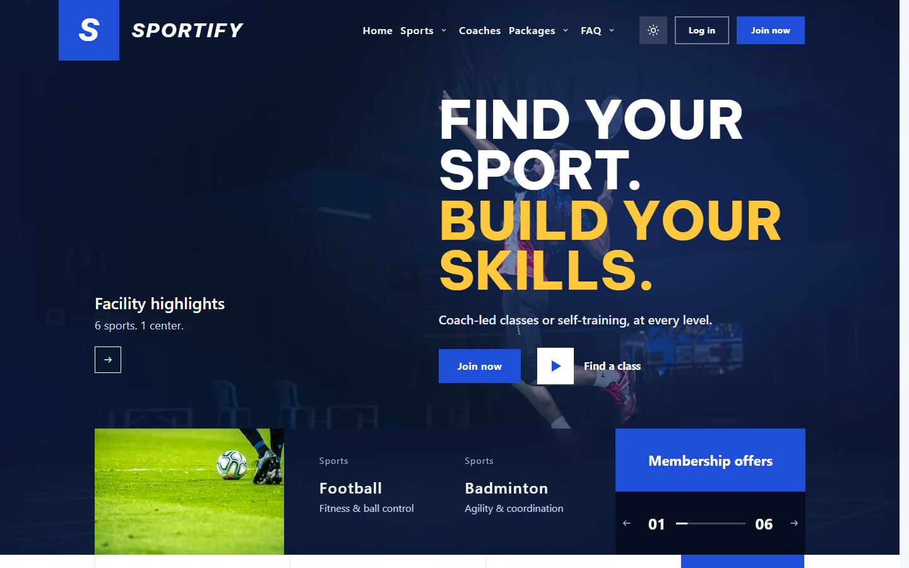
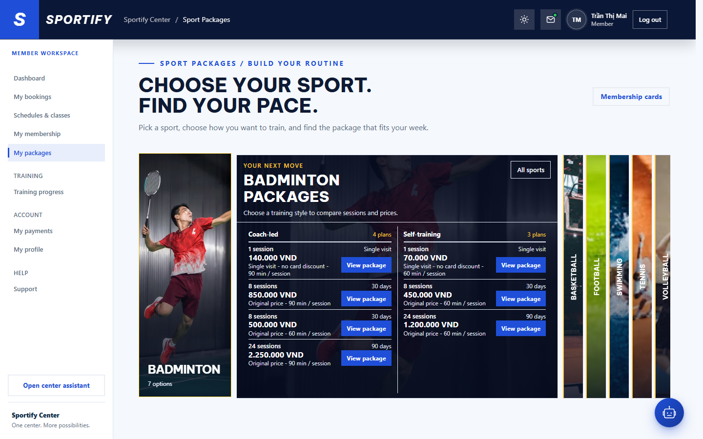
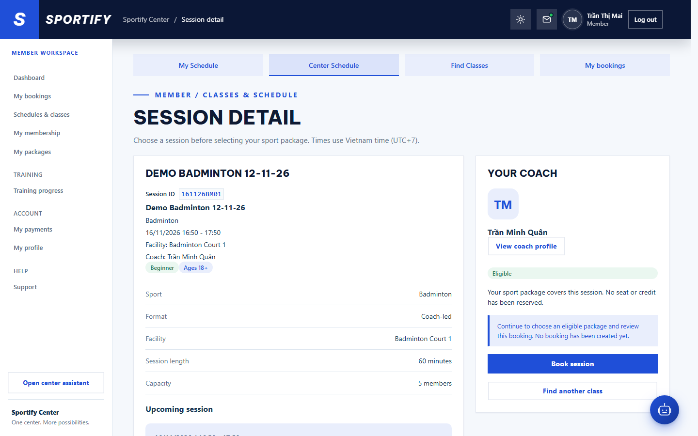
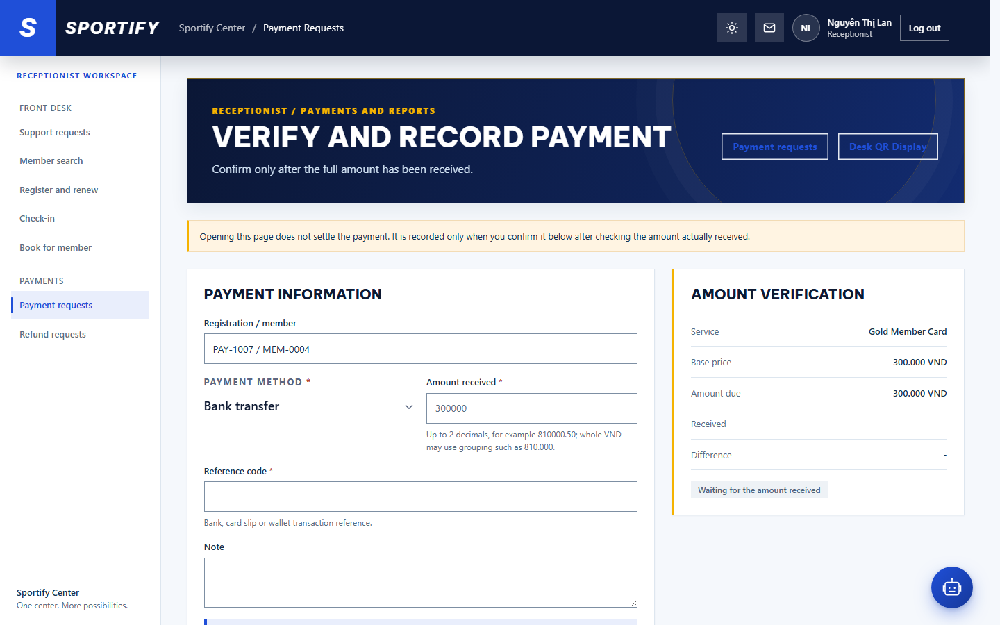
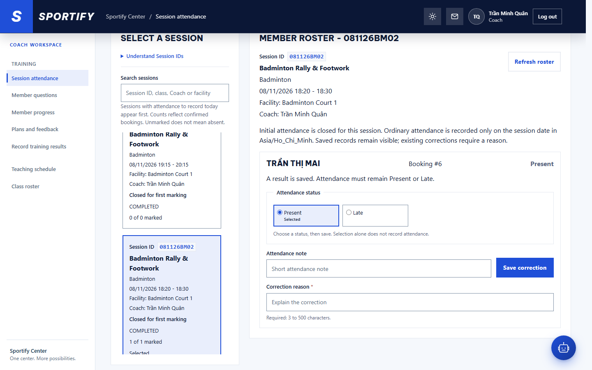
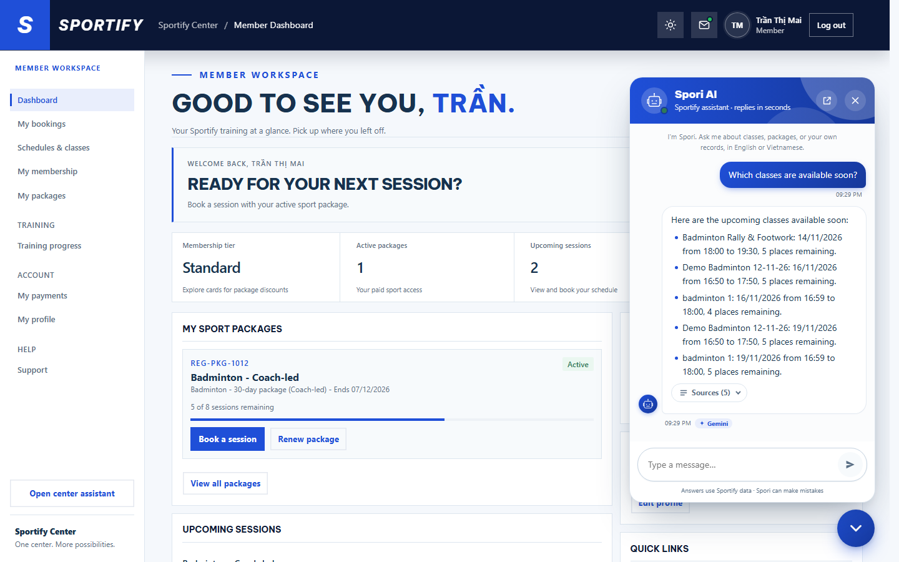

# Sportify desktop screenshot evidence

> **EVIDENCE ONLY - DO NOT MERGE.** This folder exists so CODEOWNERs can view and download current screenshots for the SRD and Final Release documents. It changes no application code and no DOCX file.

| Item | Value |
| --- | --- |
| Source commit (`main`) | `4c0edb0153aa28ca3e1d9b185416c364b4afc3ee` (PR #339 merge) |
| Capture date | 2026-11-13 (Asia/Ho_Chi_Minh, evening) |
| Browser | Chromium 141.0.7390.37 (Playwright 1.56.1, headless) |
| Viewport | 1440 x 900, device scale factor 1, light theme, reduced motion |
| Frontend | Vite dev server (`npm run dev`) on the source commit |
| Backend | Spring Boot (`mvn spring-boot:run`, profile `dev`) on the local `sportify` SQL Server database, Flyway at V59. The backend process was started from `98ebca9c`; the only commits between `98ebca9c` and `4c0edb01` change two frontend CSS files, so the backend code is identical. |
| Screenshots | 65 |

All screenshots are unedited browser captures of real application states. Nothing was retouched, mocked or stubbed: every value comes from the running backend and the `sportify` database. Each image is the visible 1440 x 900 viewport unless the file name says `Full-Page`.

## Six primary screenshots (SRD / Final Release figures)

| Figure (SRD / Final Release) | Screen | Role | Route | Evidence type |
| --- | --- | --- | --- | --- |
| D-06A / FR-04 | [Public Home](Public/Public-Home.png) | Public | `/` | UI state only |
| D-06B / FR-05 | [Member Sports & Packages](Member/Member-Sports-Packages-Catalog.png) | Member | `/member/packages?sport=2` | UI state only |
| D-06C / FR-06 | [Member Session Detail](Member/Member-Session-Detail.png) | Member | `/member/sessions/161126BM01?returnTo=%2Fmember%2Fclasses` | UI state only |
| D-06D / FR-07 | [Receptionist Payment Verification](Receptionist/Receptionist-Payment-Verification.png) | Receptionist | `/reception/payments/8` | UI state only |
| D-06E / FR-08 | [Coach Session Attendance](Coach/Coach-Session-Attendance.png) | Coach | `/coach/training/attendance` | UI state only |
| D-06F / FR-09 | [Spori AI Assistant](Member/Member-Spori-Conversation.png) | Member | `/member` | Real operation |

### D-06A / FR-04 - Public Home

Public Home landing page (first viewport).

### D-06B / FR-05 - Member Sports & Packages

Sports & Packages - Badminton package catalog with filters.

### D-06C / FR-06 - Member Session Detail

Session detail - eligible session with Book session action (not submitted).

### D-06D / FR-07 - Receptionist Payment Verification

Verify and record payment - pending transaction details (not confirmed).

### D-06E / FR-08 - Coach Session Attendance

Session attendance 081126BM02 - saved Present record for Mai (Booking #6), Present/Late options, attendance note and correction reason (nothing saved).

### D-06F / FR-09 - Spori AI Assistant

Floating Spori chat answering a suggested Sportify question.

## Full inventory

"UI state only" means the page was opened and, where noted, a tab, filter, dialog or panel was opened; no form was submitted and no record was created, changed or deleted. "Real operation" means a real request was completed against the live system.

### Public

Signed in as: Visitor (signed out).

| Screenshot | Description | Route | Evidence type |
| --- | --- | --- | --- |
| [Public-Forgot-Password.png](Public/Public-Forgot-Password.png) | Forgot password by email OTP (request step, no OTP sent) | `/login` | UI state only |
| [Public-Home-Full-Page.png](Public/Public-Home-Full-Page.png) | Public Home landing page (full scroll length) | `/` | UI state only |
| [Public-Home.png](Public/Public-Home.png) | Public Home landing page (first viewport) (**D-06A / FR-04**) | `/` | UI state only |
| [Public-Login.png](Public/Public-Login.png) | Sign in | `/login` | UI state only |
| [Public-Register.png](Public/Public-Register.png) | Member self registration | `/register` | UI state only |

### Member

Signed in as: Member - Trần Thị Mai (demo account).

| Screenshot | Description | Route | Evidence type |
| --- | --- | --- | --- |
| [Member-Booking-Options.png](Member/Member-Booking-Options.png) | Booking options - choose an eligible package (nothing submitted) | `/member/bookings/new?sessionId=161126BM01&returnTo=%2Fmember%2Fclasses` | UI state only |
| [Member-Center-Schedule.png](Member/Member-Center-Schedule.png) | Center schedule (week view) | `/member/schedules?tab=center` | UI state only |
| [Member-Dashboard.png](Member/Member-Dashboard.png) | Member dashboard | `/member` | UI state only |
| [Member-Find-Classes.png](Member/Member-Find-Classes.png) | Find classes | `/member/classes` | UI state only |
| [Member-Inbox-Beside-Avatar.png](Member/Member-Inbox-Beside-Avatar.png) | Header Inbox beside avatar (open) | `/member` | UI state only |
| [Member-Membership-Card.png](Member/Member-Membership-Card.png) | My membership - membership card tab | `/member/membership?tab=card` | UI state only |
| [Member-Membership.png](Member/Member-Membership.png) | My membership - sport packages tab | `/member/membership` | UI state only |
| [Member-My-Bookings.png](Member/Member-My-Bookings.png) | My bookings (upcoming) | `/member/bookings` | UI state only |
| [Member-My-Schedule.png](Member/Member-My-Schedule.png) | My schedule | `/member/schedule` | UI state only |
| [Member-Package-Detail.png](Member/Member-Package-Detail.png) | Package detail and registration (not submitted) | `/member/packages/24?sport=2` | UI state only |
| [Member-Payments.png](Member/Member-Payments.png) | My payments and receipts | `/member/payments?page=0&size=20` | UI state only |
| [Member-Receipt.png](Member/Member-Receipt.png) | Receipt of a completed payment | `/member/payments/receipts/9` | UI state only |
| [Member-Session-Detail-Booked.png](Member/Member-Session-Detail-Booked.png) | Session detail of an already booked session (BK-1006) | `/member/sessions/141126BM01` | UI state only |
| [Member-Session-Detail.png](Member/Member-Session-Detail.png) | Session detail - eligible session with Book session action (not submitted) (**D-06C / FR-06**) | `/member/sessions/161126BM01?returnTo=%2Fmember%2Fclasses` | UI state only |
| [Member-Spori-Chat-Open.png](Member/Member-Spori-Chat-Open.png) | Floating Spori chat opened with role prompts | `/member` | UI state only |
| [Member-Spori-Conversation.png](Member/Member-Spori-Conversation.png) | Floating Spori chat answering a suggested Sportify question (**D-06F / FR-09**) | `/member` | Real operation |
| [Member-Spori-Full-Assistant.png](Member/Member-Spori-Full-Assistant.png) | Full-page Spori assistant workspace | `/member/assistant` | UI state only |
| [Member-Sports-Packages-Catalog.png](Member/Member-Sports-Packages-Catalog.png) | Sports & Packages - Badminton package catalog with filters (**D-06B / FR-05**) | `/member/packages?sport=2` | UI state only |
| [Member-Sports-Packages.png](Member/Member-Sports-Packages.png) | Sports & Packages - sport selection | `/member/packages` | UI state only |
| [Member-Support.png](Member/Member-Support.png) | Contact reception (support requests) | `/member/support` | UI state only |
| [Member-Training-Hub.png](Member/Member-Training-Hub.png) | Training hub | `/member/training` | UI state only |

### Manager

Signed in as: Manager - System Manager (demo account).

| Screenshot | Description | Route | Evidence type |
| --- | --- | --- | --- |
| [Manager-Activity-Log.png](Manager/Manager-Activity-Log.png) | Activity log | `/manager/activity` | UI state only |
| [Manager-Attendance-Overview.png](Manager/Manager-Attendance-Overview.png) | Attendance overview | `/manager/training/attendance` | UI state only |
| [Manager-Classes.png](Manager/Manager-Classes.png) | Class management | `/manager/classes` | UI state only |
| [Manager-Dashboard-Users.png](Manager/Manager-Dashboard-Users.png) | Manager home: User management (the manager area has no separate dashboard page) | `/manager` | UI state only |
| [Manager-Finance-Overview.png](Manager/Manager-Finance-Overview.png) | Financial overview | `/manager/finance` | UI state only |
| [Manager-Inbox-Beside-Avatar.png](Manager/Manager-Inbox-Beside-Avatar.png) | Header Inbox beside avatar (open) | `/manager` | UI state only |
| [Manager-Membership-Cards.png](Manager/Manager-Membership-Cards.png) | Membership cards and benefits | `/manager/cards` | UI state only |
| [Manager-Revenue-Reports.png](Manager/Manager-Revenue-Reports.png) | Revenue reports | `/manager/reports?from=2026-11-01&to=2026-11-30` | UI state only |
| [Manager-Schedule-Sessions.png](Manager/Manager-Schedule-Sessions.png) | Schedule and coach assignment (sessions) | `/manager/schedule` | UI state only |
| [Manager-Spori-Chat-Open.png](Manager/Manager-Spori-Chat-Open.png) | Floating Spori chat opened with role prompts | `/manager` | UI state only |
| [Manager-Spori-Conversation.png](Manager/Manager-Spori-Conversation.png) | Floating Spori chat answering a suggested Sportify question | `/manager` | Real operation |
| [Manager-Sport-Packages.png](Manager/Manager-Sport-Packages.png) | Sport packages and pricing | `/manager/packages` | UI state only |
| [Manager-Transactions-Refunds.png](Manager/Manager-Transactions-Refunds.png) | Transactions and refund approval | `/manager/transactions` | UI state only |

### Receptionist

Signed in as: Receptionist - Nguyễn Thị Lan (demo account).

| Screenshot | Description | Route | Evidence type |
| --- | --- | --- | --- |
| [Receptionist-Action-Inbox.png](Receptionist/Receptionist-Action-Inbox.png) | Action inbox | `/reception/inbox` | UI state only |
| [Receptionist-Book-For-Member.png](Receptionist/Receptionist-Book-For-Member.png) | Book for member | `/reception/bookings` | UI state only |
| [Receptionist-Check-In.png](Receptionist/Receptionist-Check-In.png) | Check-in | `/reception/check-in` | UI state only |
| [Receptionist-Dashboard-Member-Search.png](Receptionist/Receptionist-Dashboard-Member-Search.png) | Receptionist home: Member search and profile | `/reception` | UI state only |
| [Receptionist-Inbox-Beside-Avatar.png](Receptionist/Receptionist-Inbox-Beside-Avatar.png) | Header Inbox beside avatar (open) | `/reception` | UI state only |
| [Receptionist-Member-Search-Result.png](Receptionist/Receptionist-Member-Search-Result.png) | Member search result for "Mai" (read only) | `/reception?q=Mai` | UI state only |
| [Receptionist-Payment-QR-Display.png](Receptionist/Receptionist-Payment-QR-Display.png) | Desk QR display for the same pending payment (VietQR payload rendered client-side, no payment confirmed) | `/reception/payments/8/qr-display` | UI state only |
| [Receptionist-Payment-Requests.png](Receptionist/Receptionist-Payment-Requests.png) | Payment requests queue | `/reception/payments` | UI state only |
| [Receptionist-Payment-Verification.png](Receptionist/Receptionist-Payment-Verification.png) | Verify and record payment - pending transaction details (not confirmed) (**D-06D / FR-07**) | `/reception/payments/8` | UI state only |
| [Receptionist-Refunds.png](Receptionist/Receptionist-Refunds.png) | Refund requests | `/reception/refunds` | UI state only |
| [Receptionist-Spori-Chat-Open.png](Receptionist/Receptionist-Spori-Chat-Open.png) | Floating Spori chat opened with role prompts | `/reception` | UI state only |
| [Receptionist-Spori-Conversation.png](Receptionist/Receptionist-Spori-Conversation.png) | Floating Spori chat answering a suggested Sportify question | `/reception` | Real operation |
| [Receptionist-Support-Inbox.png](Receptionist/Receptionist-Support-Inbox.png) | Support requests inbox with a request opened | `/reception/support` | UI state only |

### Coach

Signed in as: Coach - Trần Minh Quân (demo account).

| Screenshot | Description | Route | Evidence type |
| --- | --- | --- | --- |
| [Coach-Attendance-Sessions.png](Coach/Coach-Attendance-Sessions.png) | Session attendance - assigned session list | `/coach/training/attendance` | UI state only |
| [Coach-Dashboard-Teaching-Schedule.png](Coach/Coach-Dashboard-Teaching-Schedule.png) | Coach home: Teaching schedule (week of 09/11/2026) | `/coach?week=2026-11-02` | UI state only |
| [Coach-Inbox-Beside-Avatar.png](Coach/Coach-Inbox-Beside-Avatar.png) | Header Inbox beside avatar (open) | `/coach?week=2026-11-02` | UI state only |
| [Coach-Member-Progress.png](Coach/Coach-Member-Progress.png) | Member progress | `/coach/training/progress` | UI state only |
| [Coach-Member-Questions.png](Coach/Coach-Member-Questions.png) | Member practice questions | `/coach/training/questions` | UI state only |
| [Coach-Session-Attendance-Overview.png](Coach/Coach-Session-Attendance-Overview.png) | Session attendance - session list and selected session 081126BM02 (top of page) | `/coach/training/attendance` | UI state only |
| [Coach-Session-Attendance-Upcoming.png](Coach/Coach-Session-Attendance-Upcoming.png) | Session attendance 191126BM01 - upcoming session with 2 confirmed members (marking not open yet) | `/coach/training/attendance` | UI state only |
| [Coach-Session-Attendance.png](Coach/Coach-Session-Attendance.png) | Session attendance 081126BM02 - saved Present record for Mai (Booking #6), Present/Late options, attendance note and correction reason (nothing saved) (**D-06E / FR-08**) | `/coach/training/attendance` | UI state only |
| [Coach-Session-Roster.png](Coach/Coach-Session-Roster.png) | Class roster for session 191126BM01 (2 confirmed members) | `/coach/roster?sessionId=191126BM01&week=2026-11-16` | UI state only |
| [Coach-Spori-Chat-Open.png](Coach/Coach-Spori-Chat-Open.png) | Floating Spori chat opened with role prompts | `/coach` | UI state only |
| [Coach-Spori-Conversation.png](Coach/Coach-Spori-Conversation.png) | Floating Spori chat answering a suggested Sportify question | `/coach` | Real operation |
| [Coach-Training-Plans.png](Coach/Coach-Training-Plans.png) | Assign plans and feedback | `/coach/training/plans` | UI state only |
| [Coach-Training-Results.png](Coach/Coach-Training-Results.png) | Record training results | `/coach/training/results` | UI state only |

## Spori conversations (real Gemini replies)

Each `*-Spori-Conversation.png` sent the first suggested question once to `POST /api/v1/assistant/chat`. The replies are the actual responses from the backend (Gemini reply writer, tagged "Gemini" in the panel); they were not edited.

| Role | Question | Reply summary |
| --- | --- | --- |
| Member | Which classes are available soon? | Five upcoming sessions with remaining places, 5 sources |
| Manager | Give me an overview of the center today | 20 active members, 11 active coaches, 6 published sessions in the next 7 days, 1 open support request |
| Receptionist | What is today's session overview? | Only "Open support requests: 1"; no session list was returned (observed behaviour, not edited) |
| Coach | Show my sessions for the next 7 days | Three sessions (16/11 and 19/11) with booked counts, 4 sources |

These four questions were stored by the assistant like any other chat message. No other data was written.

## Role and route notes

- **Manager "Dashboard":** the manager area has no separate dashboard page. Its home route `/manager` is User Management, captured as `Manager-Dashboard-Users.png`; Finance Overview is the KPI view.
- **Receptionist "Dashboard":** the receptionist home route `/reception` is Member Search, captured as `Receptionist-Dashboard-Member-Search.png`.
- **Coach "Dashboard":** the coach home route `/coach` is the Teaching Schedule, captured as `Coach-Dashboard-Teaching-Schedule.png` (week 09/11 - 15/11/2026).
- **Inbox beside avatar:** captured open for all four roles. The Manager inbox is empty in this database, so its panel shows only "View all".
- **Coach attendance (D-06E / FR-08):** session `081126BM02` is completed and closed for first marking, so the screen shows the saved Present record for Booking #6 with the correction controls (status, note, required correction reason). No correction was saved. `Coach-Session-Attendance-Upcoming.png` shows session `191126BM01` with 2 confirmed members, where marking is not open yet.
- **Member session detail (D-06C / FR-06):** session `161126BM01` is in the Eligible state with the Book session action. `Member-Booking-Options.png` is the next step (package choice) and was not submitted.
- **Receptionist payment verification (D-06D / FR-07):** pending payment `PAY-1007` (Gold Member Card, 300.000 VND). The page was opened only; no payment was confirmed. `Receptionist-Payment-QR-Display.png` is the desk QR for the same payment, rendered in the browser.
- **Forgot password:** only step 1 (enter email) is shown. No OTP email was requested.

## Unavailable screens and limitations

- **Member-Payment-Cancel-Dialog.png** - not captured. Member account Mai has no PENDING payment in the sportify database (only INV-1008, Paid); the pending-payment screens and the Cancel Payment dialog for a pending payment cannot be shown without creating a new payment.
- **Member-Payment-Summary.png** - not captured. Member account Mai has no PENDING payment in the sportify database (only INV-1008, Paid); the pending-payment screens and the Cancel Payment dialog for a pending payment cannot be shown without creating a new payment.
- **Member-Payment-VietQR-Instructions.png** - not captured. Member account Mai has no PENDING payment in the sportify database (only INV-1008, Paid); the pending-payment screens and the Cancel Payment dialog for a pending payment cannot be shown without creating a new payment.
- The Member payments screens therefore show only a completed payment (`Member-Payments.png`, `Member-Receipt.png`). The VietQR payment flow is shown from the desk side (`Receptionist-Payment-QR-Display.png`).
- Screens that need data that does not exist in `sportify` (for example a coach session open for first marking today) were not created for this evidence. Creating data was out of scope.
- All people shown are demo accounts in the local `sportify` database. The Manager user list and the receptionist screens show their demo names, emails and phone numbers as stored. Please check that this is acceptable before you reuse those images in a public document.
- Captured in headless Chromium. The light strip at the right edge of each image is the page's reserved scrollbar gutter.
