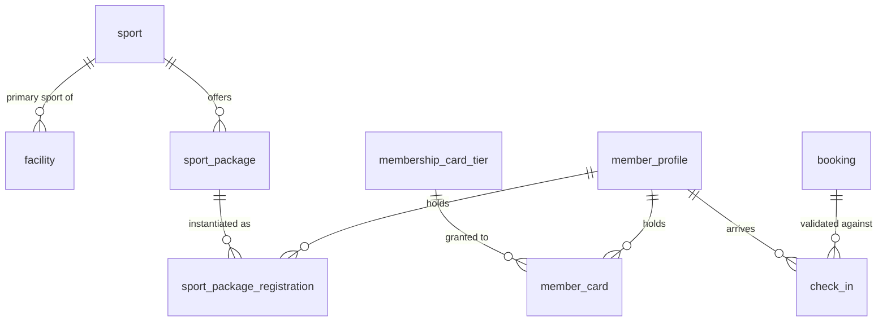

# 02 - Catalog and Membership

Screens covered: Home (sports, packages, cards), F1-03 Sport Packages, F1-04 Create or Edit Sport Package,
F1-05 Membership Cards, F1-08 Available Packages & Cards, F1-09 Package Detail & Registration,
F1-10 Membership Card Detail & Purchase, F1-11 My Packages & Cards, F1-12 Member Search & Profile,
F1-13 Register Package for Member, F1-14 Issue Membership Card for Member, F1-15 Front Desk Check-in.

## ERD (Active Architecture)



## Design Decisions

- **Sport Packages Model.** Each package is strictly tied to:
  - Exactly 1 sport (`sport_id`).
  - Exactly 1 training format (`format`: `SELF_TRAINING` or `COACH_LED`).
  - Duration in days and fixed session counts:
    - Single visit: 1 day, 1 session.
    - 30 days: 30 days, 8 sessions.
    - 90 days: 90 days, 24 sessions.
- **Multiple Active Packages.** Members can hold multiple active sport packages simultaneously (e.g., Badminton Self-training 30-day package and Swimming Coach-led 90-day package concurrently).
- **Membership Cards (Discounts Only).** Membership cards provide fixed percentage discounts on 30-day and 90-day sport package purchases:
  - Standard: Free, permanent validity, 0% discount.
  - Gold: 300,000 VND / 12 months, 5% discount on package purchases.
  - VIP: 600,000 VND / 12 months, 10% discount on package purchases.
  - Card rules: Single visits are excluded from discounts; discounts do not stack; cards do not grant direct facility admission without an active sport package session booking.
- **Explicit Start Date Selection.** When registering for a package (online or at reception), the member/staff explicitly chooses the `start_date`. Validity end date is computed as `end_date = start_date + duration_days`.
- **Front Desk Check-in (F1-15).** Front desk check-in strictly requires:
  1. An existing confirmed session booking for the member on the current day (the current date in Asia/Ho_Chi_Minh from the application Clock).
  2. The member holds an active paid sport package covering the session sport.
  3. No duplicate check-in recorded for the same session.
  4. Front desk check-in verifies arrival and does not double-deduct from attendance (which is separately logged by coaches or receptionists).
- **Legacy Compatibility.** Legacy tables (`membership_plan`, `plan_eligible_sport`, `plan_feature`, `membership`, `membership_sport`) are retained in the schema for data continuity, with their corresponding Java domain entities marked `@Deprecated`.

## Tables

### `sport`

| Column | Type | Null | Key / Default | Description |
|---|---|---|---|---|
| id | BIGINT | No | PK, IDENTITY | |
| code | NVARCHAR(30) | No | UQ | `FOOTBALL`, `BADMINTON`, `BASKETBALL`, `VOLLEYBALL`, `SWIMMING`, `TENNIS` |
| name | NVARCHAR(50) | No | UQ | Display name |
| venue_type | NVARCHAR(20) | No | | `INDOOR`, `OUTDOOR`, `POOL` |
| description | NVARCHAR(500) | Yes | | |
| image_url | NVARCHAR(500) | Yes | | |
| display_order | INT | No | 0 | |
| is_active | BIT | No | 1 | |
| created_at, updated_at | DATETIME2(0) | | | Audit |

### `facility`

| Column | Type | Null | Key / Default | Description |
|---|---|---|---|---|
| id | BIGINT | No | PK, IDENTITY | |
| code | NVARCHAR(30) | No | UQ | `BB_COURT_A`, `BB_COURT_B`, `INDOOR_POOL` |
| name | NVARCHAR(100) | No | | "Basketball Court B" |
| facility_type | NVARCHAR(20) | No | | `COURT`, `POOL`, `FIELD`, `HALL`, `STUDIO` |
| sport_id | BIGINT | Yes | FK -> sport.id | Primary sport; null = multi-purpose |
| capacity | INT | Yes | CHECK > 0 | Physical capacity |
| is_active | BIT | No | 1 | |
| created_at, updated_at | DATETIME2(0) | | | Audit |

### `membership_card_tier`

Defines the membership card discount tiers (Standard, Gold, VIP).

| Column | Type | Null | Key / Default | Description |
|---|---|---|---|---|
| id | BIGINT | No | PK, IDENTITY | |
| code | NVARCHAR(30) | No | UQ | `STANDARD`, `GOLD`, `VIP` |
| name | NVARCHAR(50) | No | | "Standard", "Gold Member", "VIP Member" |
| price | DECIMAL(14,2) | No | CHECK >= 0 | 0 for Standard, 300,000 for Gold, 600,000 for VIP |
| duration_months | INT | No | CHECK >= 0 | 0 (permanent) for Standard, 12 for Gold and VIP |
| discount_percentage | INT | No | CHECK >= 0 | 0% for Standard, 5% for Gold, 10% for VIP |
| description | NVARCHAR(500) | Yes | | Tier benefits description |
| is_active | BIT | No | 1 | |
| tier_rank | INT | No | 0 | Explicit hierarchy rank (STANDARD=1, SILVER=2, GOLD=3, VIP=4) (V22) |
| created_at, updated_at | DATETIME2(0) | | | Audit |

### `member_card`

Member's card holding record.

| Column | Type | Null | Key / Default | Description |
|---|---|---|---|---|
| id | BIGINT | No | PK, IDENTITY | |
| card_code | NVARCHAR(30) | No | UQ | `CARD-1000` from sequence |
| member_id | BIGINT | No | FK -> member_profile.user_id | Member holding card |
| tier_id | BIGINT | No | FK -> membership_card_tier.id | Current card tier |
| start_date | DATE | No | | Card start date. Recomputed from the payment date when a PENDING_PAYMENT card is activated |
| end_date | DATE | Yes | | Null for permanent Standard, date for Gold/VIP |
| status | NVARCHAR(20) | No | `ACTIVE` | `PENDING_PAYMENT`, `ACTIVE`, `EXPIRED`, `CANCELLED`, `REPLACED` (V20). `PENDING_PAYMENT` = online request not paid yet, `REPLACED` = old card after an upgrade |
| price_paid | DECIMAL(14,2) | No | CHECK >= 0 | Snapshot of fee paid |
| payment_id | BIGINT | Yes | FK -> payment.id | Associated payment (V14) |
| upgrade_request | BIT | No | 0 | Explicit marker for upgrade requests (V22). Legacy backfill requires price_paid < tier.price and an eligible same-member predecessor |
| replaces_card_id | BIGINT | Yes | FK -> member_card.id | Replaced card in upgrade chain (V22). Deterministically backfilled for ACTIVE upgrades via matching REPLACED card end_date, and PENDING_PAYMENT upgrades via active started card. Legacy rows with unresolved replaces_card_id fail closed during upgrade pricing. Enforced unique across in-force cards via filtered index ux_member_card_replaces_in_force |
| created_at, updated_at | DATETIME2(0) | | | Audit |

### `sport_package`

Specific packages offered by the center.

| Column | Type | Null | Key / Default | Description |
|---|---|---|---|---|
| id | BIGINT | No | PK, IDENTITY | |
| code | NVARCHAR(30) | No | UQ | `PKG-BADMINTON-30D`, `PKG-SWIM-90D-COACH` |
| name | NVARCHAR(100) | No | | Display name |
| sport_id | BIGINT | No | FK -> sport.id | Single sport covered |
| training_format | NVARCHAR(20) | No | | `SELF_TRAINING`, `COACH_LED` |
| duration_days | INT | No | CHECK > 0 | 1, 30, or 90 days |
| session_count | INT | No | CHECK > 0 | 1, 8, or 24 sessions |
| price_amount | DECIMAL(14,2) | No | CHECK >= 0 | Base package price in VND |
| description | NVARCHAR(500) | Yes | | Package overview |
| is_active | BIT | No | 1 | Package visibility toggle |
| created_at, updated_at | DATETIME2(0) | | | Audit |

### `sport_package_registration`

An instance of a member purchasing a sport package.

| Column | Type | Null | Key / Default | Description |
|---|---|---|---|---|
| id | BIGINT | No | PK, IDENTITY | |
| registration_code | NVARCHAR(30) | No | UQ | `REG-PKG-1000` |
| member_id | BIGINT | No | FK -> member_profile.user_id | Purchasing member |
| package_id | BIGINT | No | FK -> sport_package.id | Package purchased |
| channel | NVARCHAR(20) | No | | `ONLINE` or `RECEPTION` |
| original_price | DECIMAL(14,2) | No | CHECK >= 0 | Package base price |
| discount_percentage | INT | No | CHECK >= 0 | 0, 5, or 10 from active card tier |
| paid_amount | DECIMAL(14,2) | No | CHECK >= 0 | Amount after card discount |
| total_sessions | INT | No | CHECK > 0 | Snapshot of initial sessions |
| remaining_sessions | INT | No | CHECK >= 0 | Sessions left to book |
| start_date | DATE | No | | Explicitly chosen start date |
| end_date | DATE | No | CHECK >= start_date | `start_date + duration_days` |
| status | NVARCHAR(20) | No | `PENDING_PAYMENT` | `PENDING_PAYMENT`, `ACTIVE`, `EXPIRED`, `CANCELLED`, `REFUNDED` (V11) |
| activated_at | DATETIME2(0) | Yes | | Date activated. Activation allowed only from PENDING_PAYMENT -> ACTIVE. Recomputes start_date to TODAY and end_date = start_date + duration_days if start_date < TODAY. |
| payment_id | BIGINT | Yes | FK -> payment.id | Payment record (planned, not in V10) |
| created_by_user_id | BIGINT | No | FK -> user_account.id | Member or receptionist |
| created_at, updated_at | DATETIME2(0) | | | Audit |

### `check_in`

Front desk arrival record (F1-15).

| Column | Type | Null | Key / Default | Description |
|---|---|---|---|---|
| id | BIGINT | No | PK, IDENTITY | |
| member_id | BIGINT | No | FK -> member_profile.user_id | Arriving member |
| membership_id | BIGINT | Yes | FK -> membership.id | Legacy membership reference (nullable) |
| booking_id | BIGINT | Yes | FK -> booking.id | Today's confirmed session booking |
| package_registration_id | BIGINT | Yes | FK -> sport_package_registration.id | Active package backing admission |
| checked_in_at | DATETIME2(0) | No | SYSDATETIME() | Front desk timestamp |
| result | NVARCHAR(20) | No | | `ALLOWED`, `DENIED` |
| denial_reason | NVARCHAR(255) | Yes | | Reason if DENIED: "No confirmed booking for today", "Specified booking is not scheduled for today or is not confirmed", "All confirmed bookings for today have already been checked in", "Already checked in for this session", "Booking is not linked to a sport package registration", "No active sport package", "Sport package registration is expired or not yet valid" |
| recorded_by | BIGINT | No | FK -> user_account.id | Receptionist user |
| note | NVARCHAR(255) | Yes | | Staff note |

### Deprecated Tables (Retained for Backward Compatibility)

- `membership_plan`: Monolithic membership plan definition.
- `plan_eligible_sport`: Sports allowed under monolithic plan.
- `plan_feature`: Monolithic plan feature bullet points.
- `membership`: Monolithic membership registration periods.
- `membership_sport`: Sports chosen under monolithic membership.

## Operator Runbook: Migration V22 Upgrade Chain Verification and Unresolved Rows

### Overview
Migration V22 introduces upgrade chain tracking (`upgrade_request` and `replaces_card_id` on `member_card`) and explicit tier ranking (`tier_rank` on `membership_card_tier`). The discounted-price heuristic now also requires an eligible same-member predecessor. Purchases without that evidence retain `upgrade_request = 0`. Ambiguous predecessors or duplicate in-force targets leave an upgrade marker with a NULL link and fail closed on later upgrade attempts. Deterministic chains retain their historical `price_paid` snapshots.

### Pre-Deployment Dry-Run Queries (Production Copy)
> [!IMPORTANT]
Run V22 on a disposable staging copy first, then run the following post-migration queries and record the results in the deployment change log. These queries reference columns that do not exist at V21. No production-copy counts or persistent-environment deployment history were available for the 2026-10-14 remediation. Before deployment, confirm that V22 has not been applied in a persistent environment. If it has, preserve its applied checksum and move the revised backfill into a successor migration.

**Query 1: Dry-run count of unresolved cards grouped by status:**
```sql
SELECT 
    status,
    COUNT(*) AS unresolved_count
FROM member_card
WHERE upgrade_request = 1 
  AND replaces_card_id IS NULL
GROUP BY status;
```

**Query 2: Detailed list of affected cards with pricing comparison:**
```sql
SELECT 
    mc.id AS card_id,
    mc.card_code,
    mc.member_id,
    u.full_name AS member_name,
    u.email AS member_email,
    mct.code AS tier_code,
    mct.name AS tier_name,
    mc.price_paid,
    mct.price AS live_tier_price,
    mc.status,
    mc.start_date,
    mc.end_date,
    mc.created_at
FROM member_card mc
JOIN membership_card_tier mct ON mc.tier_id = mct.id
JOIN member_profile mp ON mc.member_id = mp.user_id
JOIN user_account u ON mp.user_id = u.id
WHERE mc.upgrade_request = 1
  AND mc.replaces_card_id IS NULL
  AND mc.status IN ('ACTIVE', 'PENDING_PAYMENT')
ORDER BY mc.member_id, mc.created_at DESC;
```

### Operational Notes & Constraints

#### 1. Promotional and Pre-Price-Increase Cards
Cards bought during a promotion or before a catalog price increase may have `price_paid < tier.price`. Without an eligible predecessor, V22 leaves `upgrade_request = 0` and `replaces_card_id = NULL`. Their historical paid amount remains the baseline for future upgrades. A price difference alone is not evidence of an upgrade. The narrowed rule is still a heuristic: rows with coincidentally matching predecessor dates require operator review.

#### 2. SQL Server `SET QUOTED_IDENTIFIER ON;` Requirement
Table `member_card` contains a filtered unique index:
`ux_member_card_replaces_in_force ON member_card(replaces_card_id) WHERE status IN ('ACTIVE', 'PENDING_PAYMENT') AND replaces_card_id IS NOT NULL;`
SQL Server requires `QUOTED_IDENTIFIER` to be `ON` for any session executing DML statements (`INSERT`, `UPDATE`, `DELETE`) against tables with filtered indexes.
When running ad-hoc SQL maintenance or scripts through command-line tools like `sqlcmd`, operators MUST explicitly issue:
```sql
SET QUOTED_IDENTIFIER ON;
```
Failure to set this will cause DML operations to abort with SQL Server error 1934 (`UPDATE failed because SET options have incorrect settings 'QUOTED_IDENTIFIER'`).

#### 3. Tier Rank Rules and Inactive Tiers
- Non-STANDARD tiers configured with `tier_rank = 0` cannot be purchased (backend rejects with HTTP 400: `Tier ranking is not configured for this tier`).
- Currently, no public or manager API modifies `tier_rank`; it is initialized via schema migration seeds (STANDARD=1, SILVER=2, GOLD=3, VIP=4).
- The filtered unique index `ux_membership_card_tier_rank` enforces rank uniqueness across all tiers where `tier_rank > 0`, including inactive tiers (`is_active = 0`). This ensures that deactivating a tier does not permit re-using its rank for another active tier, maintaining strict upgrade hierarchy invariants.

### Front-Desk Handling Procedure
When a member receives the error message "Cannot determine upgrade baseline for this membership card. Please contact the front desk.", staff should follow this resolution procedure:
1. Lookup Member: Search member in Reception Member Search (F1-12) by email, phone, or member code.
2. Review Card History: Open member overview to view all historical cards (`GET /members/{id}/overview`), identifying original card purchases and intermediate upgrades.
3. Determine Baseline Credit: Sum the actual payments (`price_paid`) made by the member toward the current active period.
4. Escalate Ambiguous Links: The normal desk sale also rejects unverifiable chains. No manual credit-adjustment API is implemented here. A maintainer must approve a data repair using verified payment evidence before another sale is attempted.
5. Record the Repair: Preserve the reviewed predecessor links, original paid snapshots, approval and deployment record.


