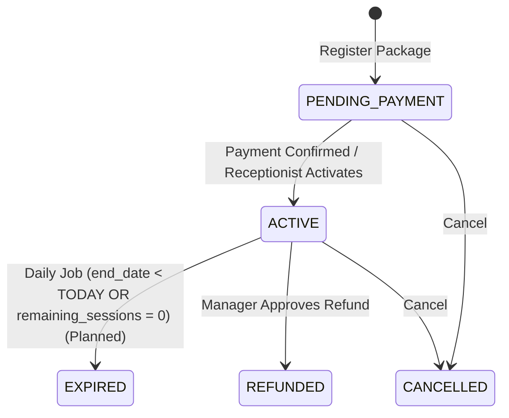
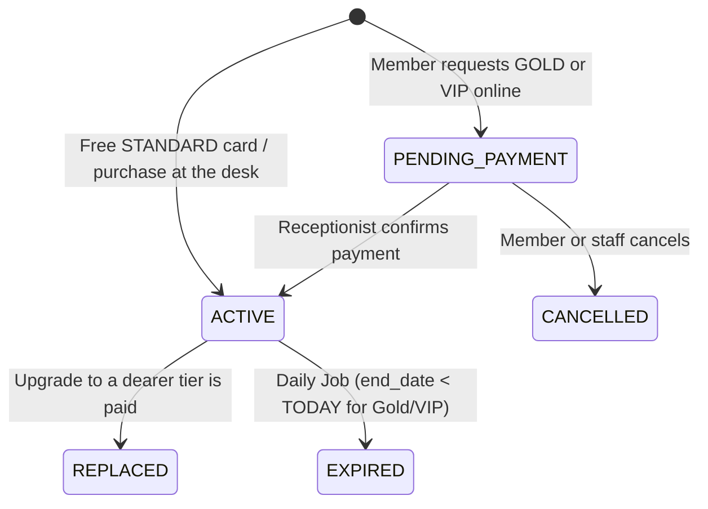
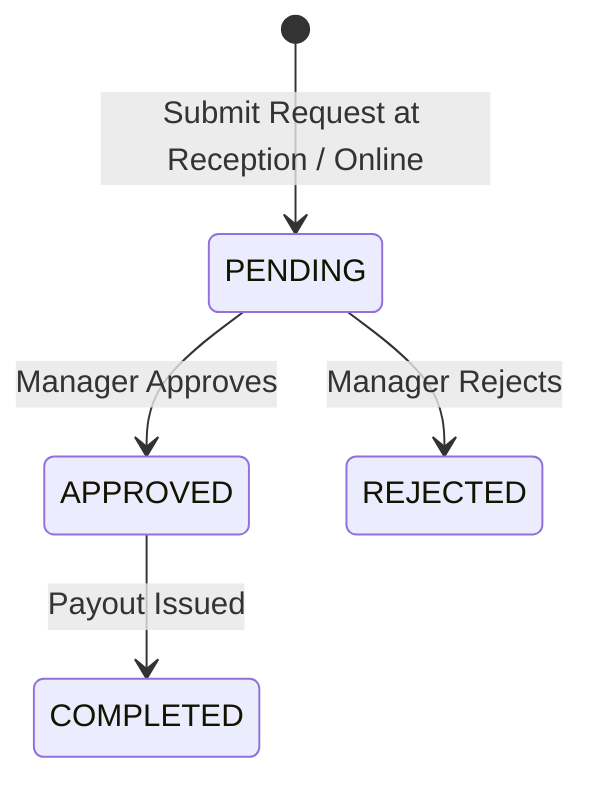
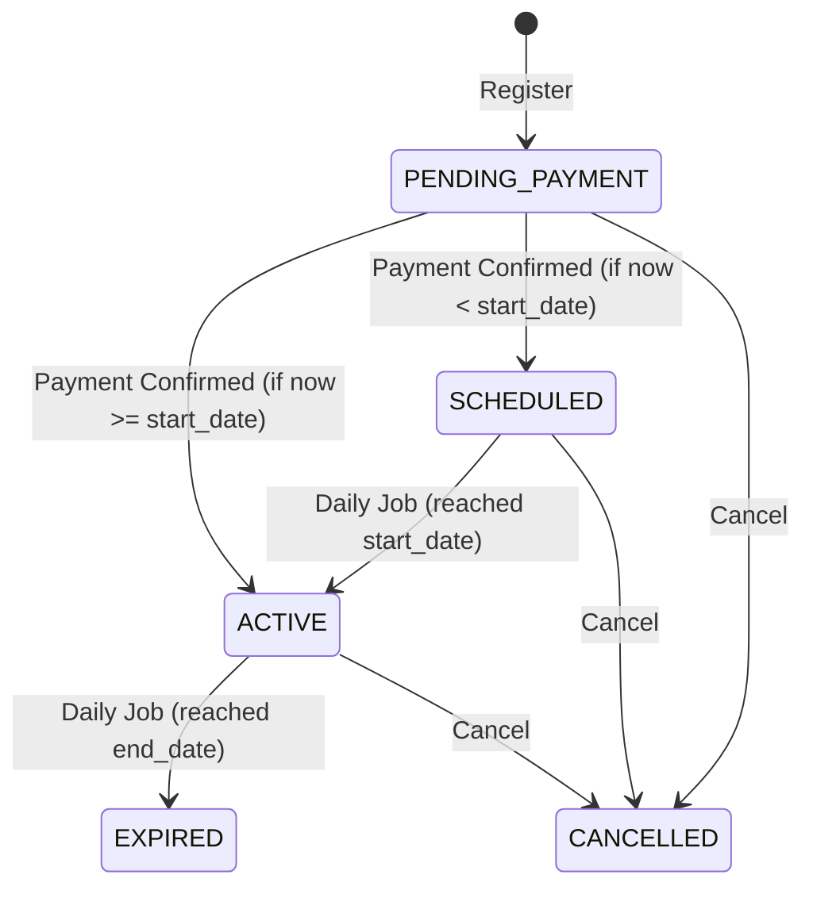
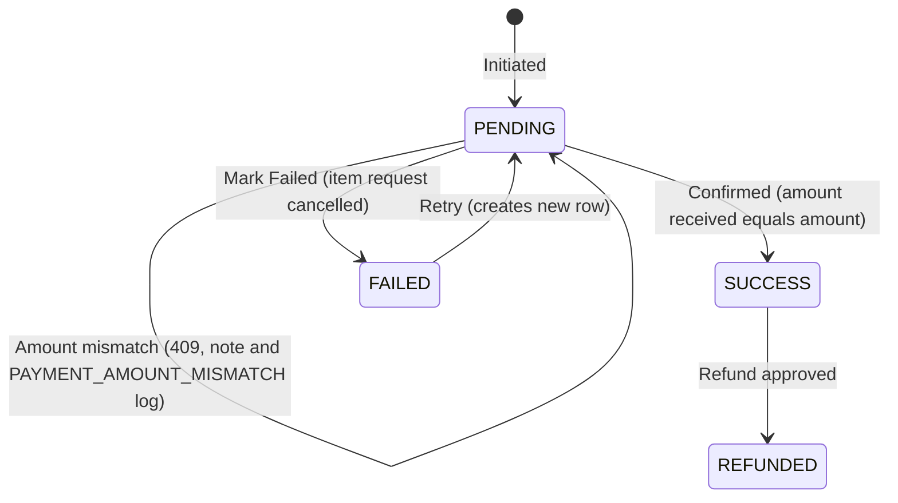
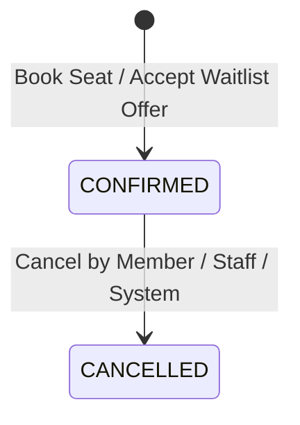
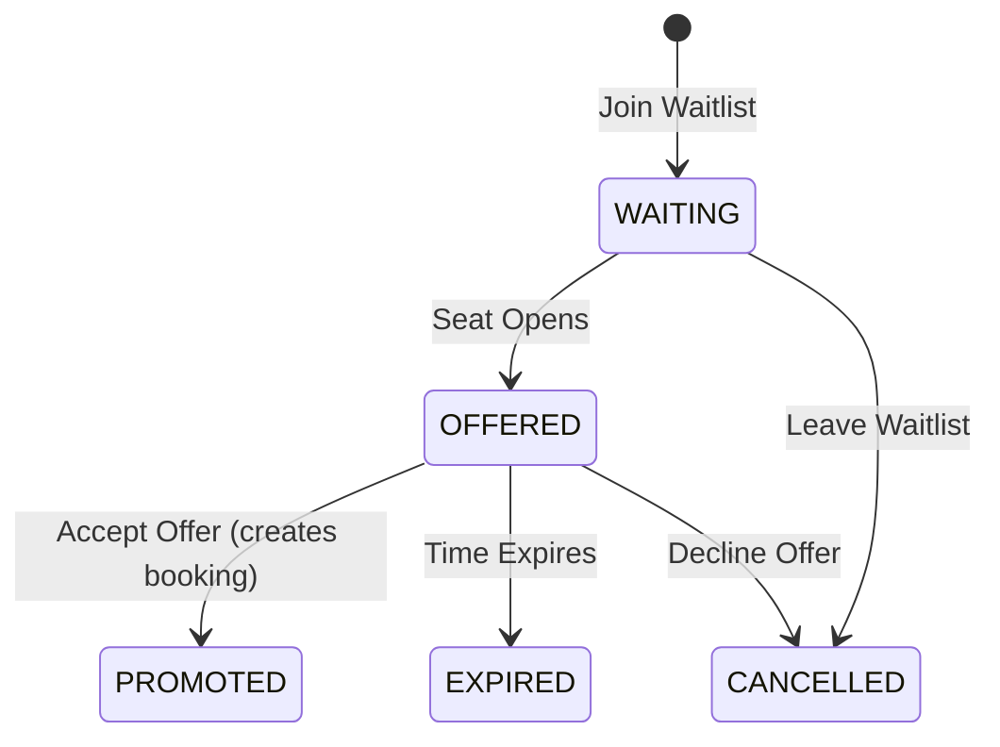
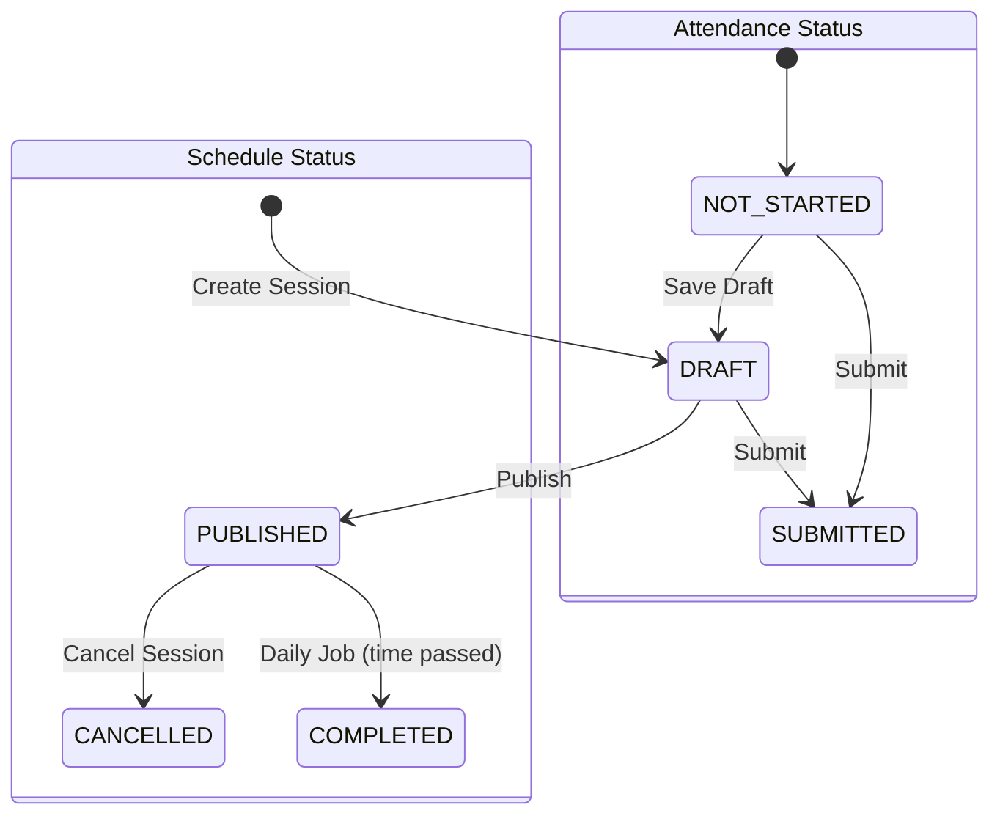
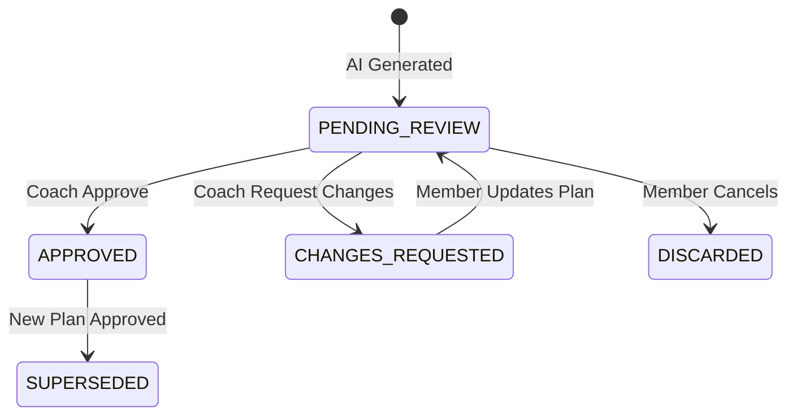
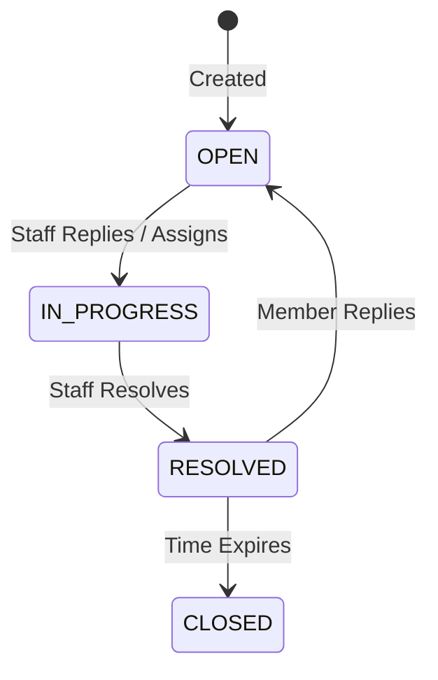

# 09 - Business Rules and State Machines

Screens covered: Global logic and flows across all flows.

## State Machines

### Sport Package Registration (`sport_package_registration.status`)

### Member Card (`member_card.status`)

### Refund Request (`refund_request.status`)

### Legacy Membership (`membership.status`)

### Payment (`payment.status`)

Payment confirmation rules (BE-18, F3-05):

| Rule | Result |
|---|---|
| Caller is not RECEPTIONIST or MANAGER | 403 (controller check, and AccessDeniedException in the service) |
| `referenceCode` missing for any method except `CASH` | 400 |
| Payment not linked to a card or a package registration | 400 |
| Payment is not `PENDING` (already confirmed, failed or refunded) | 409 `PAYMENT_NOT_PENDING` |
| `amountReceived` differs from `payment.amount` | 409 `PAYMENT_AMOUNT_MISMATCH`, payment stays `PENDING`, a note and an `activity_log` `PAYMENT_AMOUNT_MISMATCH` row are committed |
| Another receptionist confirms or fails the same payment at the same moment | The row lock makes the second call wait, then 409 `PAYMENT_NOT_PENDING` |
| Version check fails inside confirm or fail (backstop) | 409 `PAYMENT_CONCURRENT_UPDATE` |
| Item price snapshot (`paid_amount`, `price_paid`) differs from `payment.amount` (corrupted data) | 409 `PAYMENT_ITEM_AMOUNT_MISMATCH`, nothing written |
| Tier price lowered by a manager after the card request | Confirm succeeds; invoice original price = `price_paid`, discount 0 |
| Amount matches | `SUCCESS`, item `ACTIVE`, one `PAID` invoice, `activity_log` `PAYMENT_CONFIRMED` |
| Card or package activate endpoint (FE-05) | Same receipt: one `PAID` invoice and one `PAYMENT_CONFIRMED` row; no reference needed, amount received = amount |

### Booking (`booking.status`)

### Waitlist (`waitlist_entry.status`)

### Class Session (`class_session.status` & `attendance_status`)

### Workout Plan (`workout_plan.status`)

### Support Request (`support_request.status`)

## Front Desk Check-in Rules (Screen F1-15)

Front desk check-in validates member arrival at the center:

1. **Today's Confirmed Booking Required:** The member MUST have at least one confirmed session booking for the current day (the current date in Asia/Ho_Chi_Minh from the application Clock, `status = 'CONFIRMED'`).
2. **Active Package Coverage:** The booked package registration must be ACTIVE and valid today (start_date <= today <= end_date).
3. **No Duplicate Check-in:** The member must not have already checked in for the same session today.
4. **Attendance Independence:** Front desk check-in does not mark session attendance and does not double-deduct remaining package sessions (attendance is separately recorded by coaches in classes or receptionists in self-training slots).
5. **Result & Denial Reasons:**
   - If conditions 1 and 2 are satisfied, result is `ALLOWED`.
   - If no confirmed booking exists for today, result is `DENIED` with reason `"No confirmed booking for today"`.
   - If a specific booking ID is provided in request but is not found, not confirmed, or not scheduled for today, result is `DENIED` with reason `"Specified booking is not scheduled for today or is not confirmed"`.
   - If all confirmed bookings for today have already been checked in, result is `DENIED` with reason `"All confirmed bookings for today have already been checked in"`.
   - If already checked in for the target session, result is `DENIED` with reason `"Already checked in for this session"`.
   - If booking has no linked package registration, result is `DENIED` with reason `"Booking is not linked to a sport package registration"`.
   - If the linked package registration status is not active, result is `DENIED` with reason `"No active sport package"`.
   - If today is outside the package validity period (`today < startDate` or `today > endDate`), result is `DENIED` with reason `"Sport package registration is expired or not yet valid"`.

## Membership Card & Discount Rules

1. **Card Validity:**
   - Standard Card (STANDARD): Free, permanent validity, 0% discount.
   - Gold Card (GOLD): 300,000 VND / 12 months, 5% discount on 30-day and 90-day packages.
   - VIP Card (VIP): 600,000 VND / 12 months, 10% discount on 30-day and 90-day packages.
2. **Discount Scope & Exclusions:**
   - Single-visit packages (1 day, 1 session) are strictly EXCLUDED from discounts.
   - Discounts apply only to 30-day and 90-day packages.
   - Discounts do not stack. The member's single highest active card discount is applied.
3. **One card at a time (implemented):**
   - Same tier: renewal starts the day after the current card ends.
   - Dearer tier while a card is valid: upgrade from today, keeps the current end date, the member pays only the price difference. The old card becomes `REPLACED` when the payment is confirmed.
   - Cheaper tier: starts the day after the current card ends, full price.
   - Only one `PENDING_PAYMENT` request per member. An upgrade is refused while a renewal is already paid.
   - End date = start + months - 1 day. A card that has not started yet gives no discount.

### Rules vs. Code

| Rule | Status |
|---|---|
| Online card request waits for payment (`PENDING_PAYMENT`) | Done |
| Upgrade pays the difference, old card `REPLACED` | Done |
| Card and package end date = start + duration - 1 day | Done |
| One confirmed booking per member and session (`ux_booking_active`) | Done (database) |
| Cancel unpaid card requests after 7 days | Not done |
| Map `sport_class.coach_id`, `booking.cancelled_by_user_id`, `member_card.payment_id` in entities | Not done |
| Front desk confirms a card or package payment with the exact amount, invoice issued (BE-18) | Done |

## Sport Package & Booking Eligibility Rules

1. **Multiple Concurrent Packages:** Members can hold multiple active packages simultaneously across different sports and formats.
2. **Session Reservation & Deduction:** Booking a session immediately reserves and deducts 1 session from `remaining_sessions` (`POST /api/v1/bookings`). Cancelling a confirmed booking (`DELETE /api/v1/bookings/{id}`) restores 1 session to `remaining_sessions` only when the registration is ACTIVE; cancellation is blocked after an ALLOWED check-in, after the session date, or once the session start time has been reached on the session day when requested by a MEMBER (staff are exempt).
3. **Registration Activation Rules:**
   - Status transition: Strictly allowed only from `PENDING_PAYMENT` -> `ACTIVE`. Transition from any other status (`ACTIVE`, `CANCELLED`, `REFUNDED`, `EXPIRED`) throws a business rule error.
   - Channel and role enforcement: Registrations created by a `MEMBER` actor always force channel `ONLINE` and status `PENDING_PAYMENT`. Only `RECEPTIONIST` and `MANAGER` staff actors can create immediate `ACTIVE` registrations with channel `RECEPTION`.
   - Date recomputation at activation: If `startDate` is in the past when activation occurs (`startDate < TODAY`), `startDate` is reset to `TODAY` and `endDate` is set to `startDate + durationDays`. If `startDate >= TODAY`, dates are preserved unchanged.
   - Refund terminal status: Approved refunds transition the associated package registration status to `REFUNDED`.
4. **Booking Eligibility Checklist:**
   - Session State: `PUBLISHED` and not in the past (today allowed) (Implemented).
   - Session not started: booking is rejected once the session start time is reached (Implemented).
   - Capacity: Available seats (`capacity - booked_count > 0`, Implemented; waitlist prompt is Planned).
   - Package Coverage: Active package for the session sport with `remaining_sessions > 0` and `session_date` between `start_date` and `end_date` (Implemented).
   - Format Match: Self-training package for self-training sessions; Coach-led package for coach-led classes (Implemented for explicit package selection; Planned for automatic package lookup).
   - Age Restriction: Member's age falls within `age_group` range (Planned).
   - No Overlap: Member does not have an overlapping confirmed booking (Planned).
   - Double Booking: Application-level check only (not race-safe, no unique index in V10) (Implemented).

## Refund Rules

1. **Eligibility:** Refund requests can be submitted at reception (`F3-07`) or initiated by members for active package registrations.
2. **Amount Calculation:** Pro-rated based on unused remaining sessions:
   - `refund_amount = (remaining_sessions / total_sessions) * paid_amount`
3. **Manager Approval:** Center Manager must review all pending refund requests (`F3-09`).
4. **Resolution:** Upon Manager approval, refund status becomes `APPROVED` (Implemented), and upon disbursement becomes `COMPLETED` (Planned; RefundController endpoints only implement submission, pending list, and review to APPROVED or REJECTED: `RefundController.java:35` `submitRefund`, `RefundController.java:41` `getPendingRefunds`, `RefundController.java:47` `reviewRefund`). The package registration status transitions to `REFUNDED`. If rejected, status is `REJECTED` with a mandatory reason note.

## Critical Transactions & Concurrency Control (Target design - not yet implemented)

### Booking a Seat

1. `UPDATE class_session SET booked_count = booked_count + 1 WHERE id = @id AND booked_count < capacity`
2. If row count is 0, session is full. Return error or prompt waitlist.
3. Decrement package remaining sessions:
   `UPDATE sport_package_registration SET remaining_sessions = remaining_sessions - 1 WHERE id = @pkgId AND remaining_sessions > 0`
4. Insert `booking` row (`status = 'CONFIRMED'`).

### Cancelling a Booking

1. Update `booking` status to `CANCELLED`.
2. `UPDATE class_session SET booked_count = booked_count - 1 WHERE id = @id`.
3. Restore package session:
   `UPDATE sport_package_registration SET remaining_sessions = remaining_sessions + 1 WHERE id = @pkgId`.
4. Check `waitlist_entry` for the oldest `WAITING` entry and offer seat.

### Confirming a Payment (implemented in BE-18)

**Lock order rule.** Every path that changes a payment together with the card or package registration it pays for locks the `payment` row first (`PaymentRepository.findByIdForUpdate`, PESSIMISTIC_WRITE, SQL Server UPDLOCK HOLDLOCK) and only then reads and writes the card or registration. This covers `PUT /payments/{id}/confirm`, `PUT /payments/{id}/fail`, `PUT /membership-cards/{id}/activate`, `PUT /membership-cards/{id}/cancel`, `PUT /packages/registrations/{id}/activate` and `PUT /packages/registrations/{id}/cancel`. The card and package services read only the payment id before the lock (`findPaymentIdById`, a single-value query, no entity), call `PaymentService.lockPayment`, then load the card or registration and run their checks on its current state. Locking again inside the same transaction (confirm and fail call activate or cancel) is harmless. The database does not use READ_COMMITTED_SNAPSHOT, so without one order a payment lock and a card lock held by two requests could wait on each other (deadlock, HTTP 500 for the victim). Items without a payment are not locked. Scope: paths that lock one payment and then its own card or registration cannot deadlock with each other. Known remaining case: an upgrade activation also reads and replaces the member's current card, so two different payments of the same member (for example an upgrade confirmed while another request of that member is cancelled) are not ordered against each other; accepted as very unlikely.

1. Validate the request (`referenceCode` for non-cash methods) and check the caller is staff (403 otherwise).
2. Read the payment with a pessimistic write lock (`findByIdForUpdate`, SQL Server UPDLOCK HOLDLOCK). A concurrent confirm, fail, activate or cancel on the same payment waits here.
3. Verify status is `PENDING`, otherwise 409 `PAYMENT_NOT_PENDING`.
4. Compare `amountReceived` with `amount`. On a difference, append the mismatch note, write `activity_log` `PAYMENT_AMOUNT_MISMATCH`, commit only those, answer 409 `PAYMENT_AMOUNT_MISMATCH`.
5. Store `reference_code`, activate the member card or package registration (dates recomputed from today); activation sets `payment_status = 'SUCCESS'`, `payment_time` and `confirmed_by_user_id`.
6. `recordPaymentConfirmed`: issue `invoice` (status `PAID`) and one `invoice_line` snapshot with the original price and discount from `PaymentItemResolver`; if original price - discount does not equal the payment amount, nothing is written (409 `PAYMENT_ITEM_AMOUNT_MISMATCH`); insert `activity_log` `PAYMENT_CONFIRMED` (details: method, reference, amount, item, invoice number, note). The card and package activate endpoints call the same method.
7. Flush: `@Version` on `payment` stays as a backstop; a failure answers 409 `PAYMENT_CONCURRENT_UPDATE` (other modules keep the generic 409 body).

## Scheduled Jobs

1. **Package Expiration:** Daily at midnight, set packages to `EXPIRED` if `end_date < TODAY` or `remaining_sessions = 0` (Planned). Note: The remaining_sessions = 0 condition conflicts with strict check-in and must be decided before the job is built.
2. **Card Expiration:** Daily at midnight, set member cards to `EXPIRED` if `end_date < TODAY` (Planned).
5. **Unpaid Card Requests:** Daily, cancel `PENDING_PAYMENT` member cards older than 7 days (Planned).
3. **Session Completion:** Hourly, mark sessions as `COMPLETED` when session date and time have passed (Planned).
4. **Waitlist Expiry:** Hourly, expire offered waitlist entries that exceeded the acceptance window (Planned).
*(Note: Active scheduled job `MembershipScheduledJobs` currently processes legacy `membership` table transitions only).*
