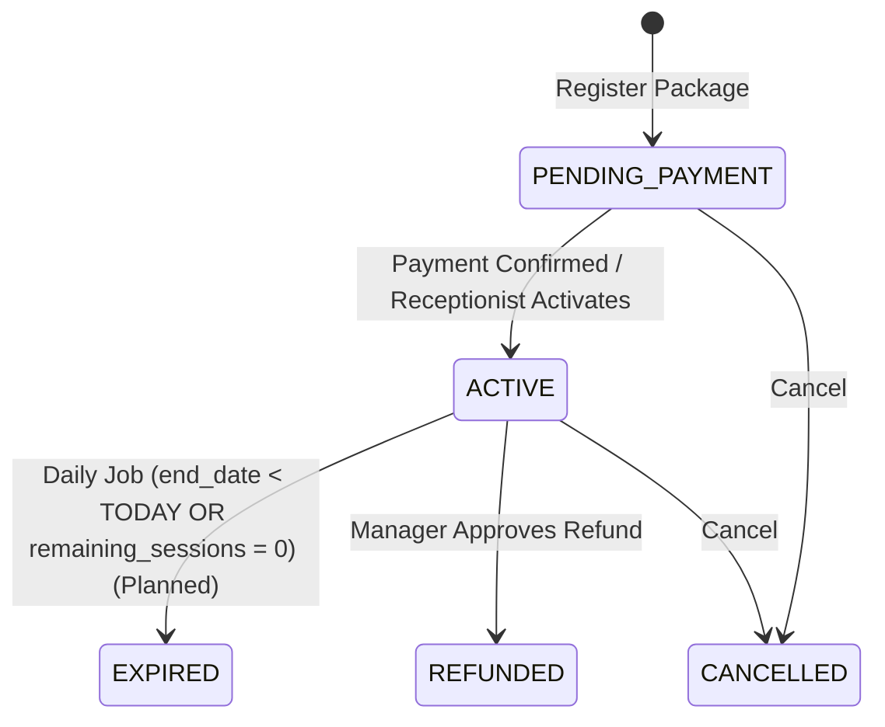
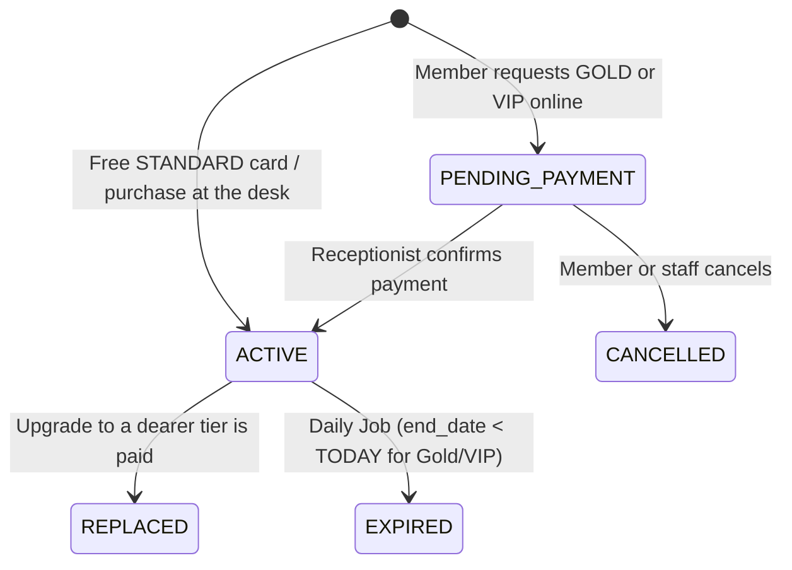
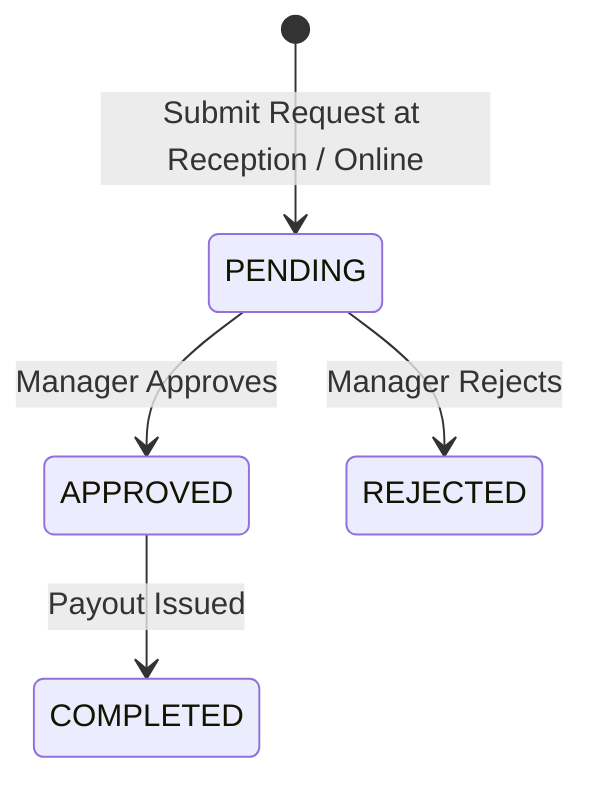
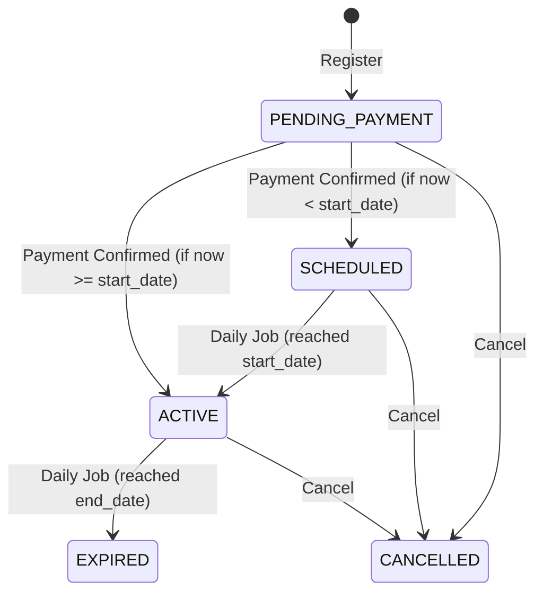
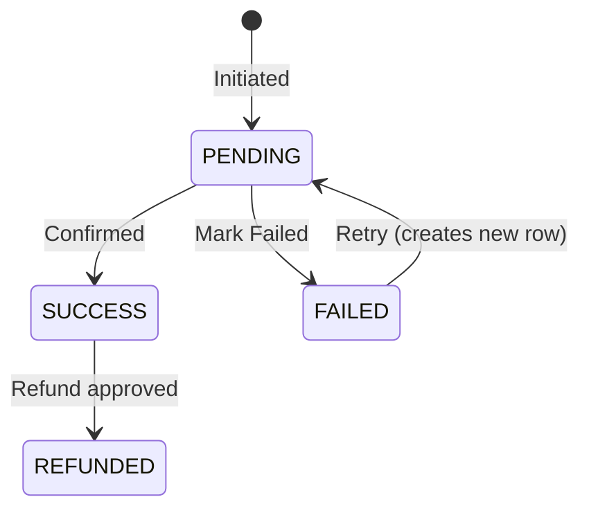
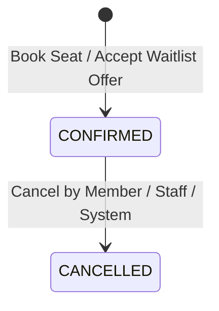
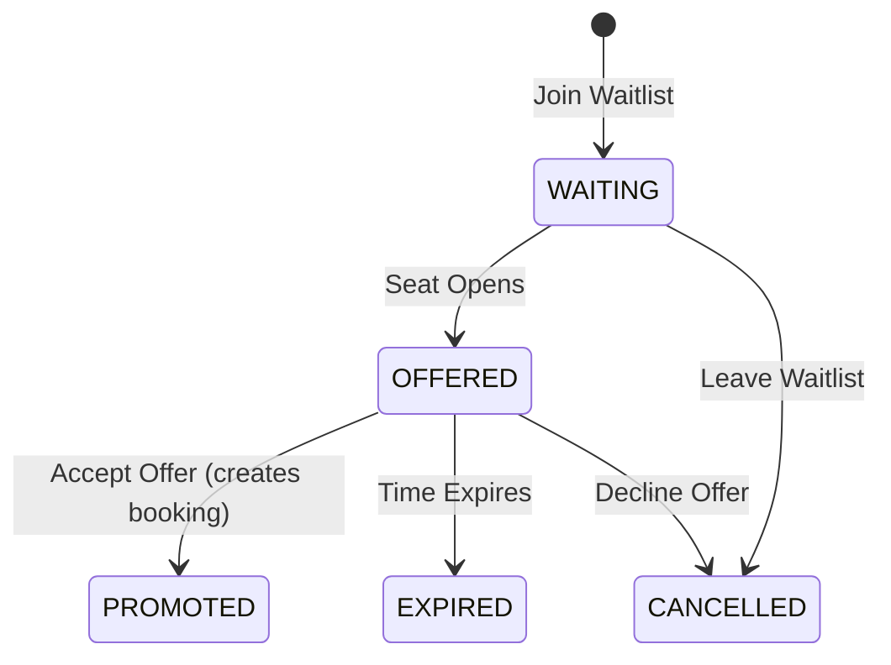
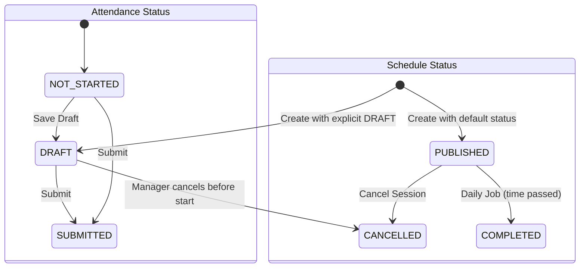
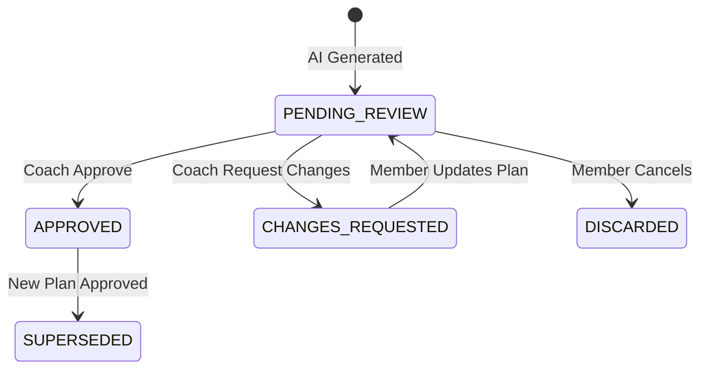
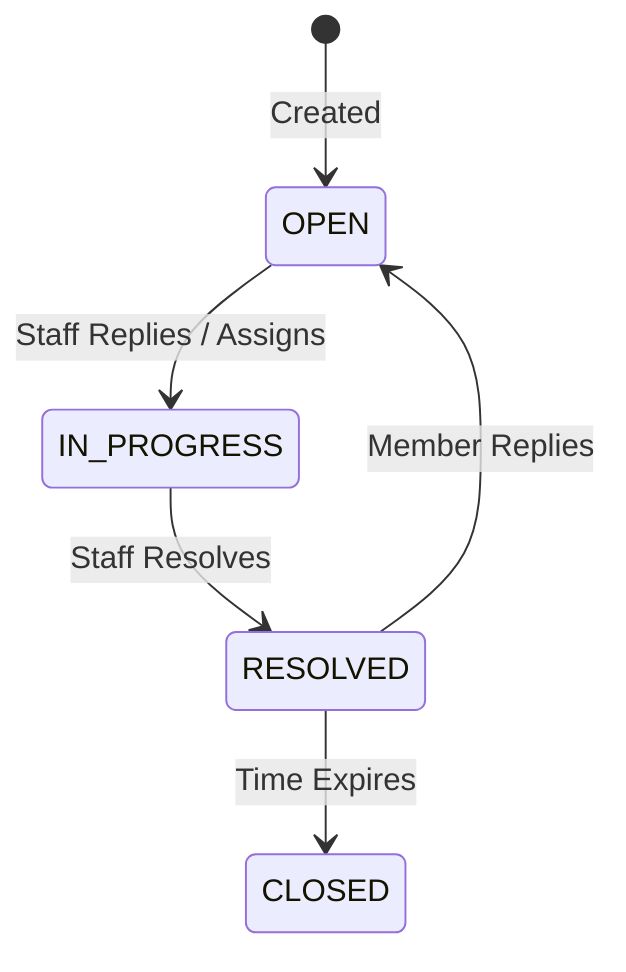

# 09 - Business Rules and State Machines

Screens covered: Global logic and flows across all flows.

## State Machines

### Sport Package Registration (`sport_package_registration.status`)

### Member Card (`member_card.status`)

### Refund Request (`refund_request.status`)

### Legacy Membership (`membership.status`)

### Payment (`payment.status`)

### Booking (`booking.status`)

### Waitlist (`waitlist_entry.status`)

### Class Session (`class_session.status` & `attendance_status`)

### Workout Plan (`workout_plan.status`)

### Support Request (`support_request.status`)

## Front Desk Check-in Rules (Screen F1-15)

Front desk check-in validates member arrival at the center:

1. **Today's Confirmed Booking Required:** The member MUST have at least one confirmed session booking for the current day (the current date in Asia/Ho_Chi_Minh from the application Clock, `status = 'CONFIRMED'`).
2. **Active Package Coverage:** The booked package registration must be ACTIVE and valid today (start_date <= today <= end_date).
3. **No Duplicate Check-in:** The member must not have already checked in for the same session today.
4. **Attendance Independence:** Front desk check-in does not mark session attendance and does not double-deduct remaining package sessions (attendance is separately recorded by coaches in classes or receptionists in self-training slots).
5. **Result & Denial Reasons:**
   - If conditions 1 and 2 are satisfied, result is `ALLOWED`.
   - If no confirmed booking exists for today, result is `DENIED` with reason `"No confirmed booking for today"`.
   - If a specific booking ID is provided in request but is not found, not confirmed, or not scheduled for today, result is `DENIED` with reason `"Specified booking is not scheduled for today or is not confirmed"`.
   - If all confirmed bookings for today have already been checked in, result is `DENIED` with reason `"All confirmed bookings for today have already been checked in"`.
   - If already checked in for the target session, result is `DENIED` with reason `"Already checked in for this session"`.
   - If booking has no linked package registration, result is `DENIED` with reason `"Booking is not linked to a sport package registration"`.
   - If the linked package registration status is not active, result is `DENIED` with reason `"No active sport package"`.
   - If today is outside the package validity period (`today < startDate` or `today > endDate`), result is `DENIED` with reason `"Sport package registration is expired or not yet valid"`.

## Membership Card & Discount Rules

1. **Card Validity:**
   - Standard Card (STANDARD): Free, permanent validity, 0% discount.
   - Gold Card (GOLD): 300,000 VND / 12 months, 5% discount on 30-day and 90-day packages.
   - VIP Card (VIP): 600,000 VND / 12 months, 10% discount on 30-day and 90-day packages.
2. **Discount Scope & Exclusions:**
   - Single-visit packages (1 day, 1 session) are strictly EXCLUDED from discounts.
   - Discounts apply only to 30-day and 90-day packages.
   - Discounts do not stack. The member's single highest active card discount is applied.
3. **One card at a time (implemented):**
   - Same tier: renewal starts the day after the current card ends.
   - Dearer tier while a card is valid: upgrade from today, keeps the current end date, the member pays only the price difference. The old card becomes `REPLACED` when the payment is confirmed.
   - Cheaper tier: starts the day after the current card ends, full price.
   - Only one `PENDING_PAYMENT` request per member. An upgrade is refused while a renewal is already paid.
   - End date = start + months - 1 day. A card that has not started yet gives no discount.

### Rules vs. Code

| Rule | Status |
|---|---|
| Online card request waits for payment (`PENDING_PAYMENT`) | Done |
| Upgrade pays the difference, old card `REPLACED` | Done |
| Card and package end date = start + duration - 1 day | Done |
| One confirmed booking per member and session (`ux_booking_active`) | Done (database) |
| Cancel unpaid card requests after 7 days | Not done |
| Map `sport_class.coach_id`, `booking.cancelled_by_user_id`, `member_card.payment_id` in entities | Not done |

## Sport Package & Booking Eligibility Rules

1. **Multiple Concurrent Packages:** Members can hold multiple active packages simultaneously across different sports and formats.
2. **Session Reservation & Deduction:** Booking a session immediately reserves and deducts 1 session from `remaining_sessions` (`POST /api/v1/bookings`). Cancelling a confirmed booking (`DELETE /api/v1/bookings/{id}`) restores at most 1 session to `remaining_sessions` only when the database registration status is ACTIVE, capped at `total_sessions`; cancellation is blocked after an ALLOWED check-in, after the session date, or once the session start time has been reached on the session day when requested by a MEMBER (staff are exempt).
3. **Registration Activation Rules:**
   - Status transition: Strictly allowed only from `PENDING_PAYMENT` -> `ACTIVE`. Transition from any other status (`ACTIVE`, `CANCELLED`, `REFUNDED`, `EXPIRED`) throws a business rule error.
   - Channel and role enforcement: Registrations created by a `MEMBER` actor always force channel `ONLINE` and status `PENDING_PAYMENT`. Only `RECEPTIONIST` and `MANAGER` staff actors can create immediate `ACTIVE` registrations with channel `RECEPTION`.
   - Date recomputation at activation: If `startDate` is in the past when activation occurs (`startDate < TODAY`), `startDate` is reset to `TODAY` and `endDate` is set to `startDate + durationDays`. If `startDate >= TODAY`, dates are preserved unchanged.
   - Refund terminal status: Approved refunds transition the associated package registration status to `REFUNDED`.
4. **Booking Eligibility Checklist:**
   - Session State: `PUBLISHED` and not in the past (today allowed) (Implemented).
   - Session not started: booking is rejected once the session start time is reached (Implemented).
   - Capacity: Available seats (`capacity - booked_count > 0`, Implemented; waitlist prompt is Planned).
   - Package Coverage: Active package for the session sport with `remaining_sessions > 0` and `session_date` between `start_date` and `end_date` (Implemented).
   - Format Match: Self-training package for self-training sessions; Coach-led package for coach-led classes (Implemented for explicit package selection; Planned for automatic package lookup).
   - Age Restriction: Member's age falls within `age_group` range (Planned).
   - No Overlap: Member does not have an overlapping confirmed booking (Planned).
   - Double Booking: Application-level check only (not race-safe, no unique index in V10) (Implemented).

## Refund Rules

1. **Eligibility:** Refund requests can be submitted at reception (`F3-07`) or initiated by members for active package registrations.
2. **Amount Calculation:** Pro-rated based on unused remaining sessions:
   - `refund_amount = (remaining_sessions / total_sessions) * paid_amount`
3. **Manager Approval:** Center Manager must review all pending refund requests (`F3-09`).
4. **Resolution:** Upon Manager approval, refund status becomes `APPROVED` (Implemented), and upon disbursement becomes `COMPLETED` (Planned; RefundController endpoints only implement submission, pending list, and review to APPROVED or REJECTED: `RefundController.java:35` `submitRefund`, `RefundController.java:41` `getPendingRefunds`, `RefundController.java:47` `reviewRefund`). The package registration status transitions to `REFUNDED`. If rejected, status is `REJECTED` with a mandatory reason note.

## Critical Transactions & Concurrency Control (Target design)

Current booking paths already lock the session row and use conditional package consumption plus ACTIVE-only capped restoration, as detailed below. The examples in this target design section are illustrative; atomic session counters and waitlist promotion are not fully implemented.

### Booking a Seat

1. `UPDATE class_session SET booked_count = booked_count + 1 WHERE id = @id AND booked_count < capacity`
2. If row count is 0, session is full. Return error or prompt waitlist.
3. Decrement package remaining sessions:
   `UPDATE sport_package_registration SET remaining_sessions = remaining_sessions - 1 WHERE id = @pkgId AND remaining_sessions > 0`
4. Insert `booking` row (`status = 'CONFIRMED'`).

### Cancelling a Booking

1. Update `booking` status to `CANCELLED`.
2. `UPDATE class_session SET booked_count = booked_count - 1 WHERE id = @id`.
3. Restore package session:
   `UPDATE sport_package_registration SET remaining_sessions = remaining_sessions + 1 WHERE id = @pkgId`.
4. Check `waitlist_entry` for the oldest `WAITING` entry and offer seat.

### Confirming a Payment

1. Pessimistic lock on `payment` to prevent double confirmation.
2. Verify status is `PENDING`.
3. Set `payment_status` to `SUCCESS` and record `payment_time` (V14 has no `amount_received` column).
4. Activate corresponding package registration or member card.
5. Issue `invoice` (status `PAID`) and itemized `invoice_line` snapshot with applied discounts.
6. Insert `activity_log`.

## Manager Session Scheduling and Cancellation BE-10

1. Calendar ranges include both endpoints and contain at most 62 calendar days. Missing bounds, reversed bounds and out-of-database-range dates return 400. Unknown optional filter ids produce an empty calendar.
2. Creation selects exactly one mode: one date, or a complete weekly recurrence. Recurrences select named weekdays in the inclusive range and generate 1 through 100 sessions. PUBLISHED is the default; DRAFT is the only alternate creation status. DRAFT occupies resources and requires the same assignments as PUBLISHED. There is no draft-to-published endpoint in BE-10; whether to add one remains a product question. If a selected occurrence today has already reached its start time, the complete weekly batch returns 400 instead of skipping that date.
3. COACH_LED requires an active COACH account with a `coach_sport` row for the class sport. SELF_TRAINING allows a null coach; a supplied coach is validated. The linked class and facility must be active. Capacity must be within 1 and the class maximum. On edit, capacity cannot go below the confirmed bookings counted at update time. If confirmed bookings exist, one count query rejects a new date outside any linked package registration's inclusive validity period before coach/facility locks; bookings with no registration are ignored. Time-only and coach changes remain allowed, an assumption requiring product owner confirmation. Updates leave cached `booked_count` unchanged; response counts still use confirmed booking rows.
4. Only future DRAFT or PUBLISHED sessions can be edited or cancelled. The exact start time is already started. Repeated cancellation returns 400, preventing duplicate refunds. Editing time or coach with existing bookings is allowed; no notifications are sent. Cancelled and completed sessions remain visible on the calendar.
5. Resource overlap is checked with strict inequalities, so adjacent sessions are allowed. Coach and facility matches are queried separately using resource/date indexes; a matching session is returned once, with conflict type COACH, FACILITY or BOTH. An edit excludes itself. Every generated date is checked before any batch insertion; one conflict rejects the complete batch with 409 and all conflict details.
6. Scheduling creates lock coach then facility; updates lock the session first, then coach, then facility. Each operation assigns at most one of each resource, so no within-type id ordering is needed. Manager cancellation locks the session first, then the confirmed booking range, then registrations. Booking creation locks the session before status/capacity checks and booking/registration writes. Individual booking cancellation resolves a scalar session id, locks the session before loading the booking entity, and checks fresh booking state before writes. Locks, conflict checks, persistence and audit share one transaction. Concurrent overlapping BE-10 creates cannot both commit. Pessimistic lock failures thrown inside the manager service method body receive retryable 409 guidance. Commit-time failures occur outside withLockHandling and can still become 500. Locks have no timeout and may hold a database connection while waiting. Any timeout policy needs a project-wide decision shared with BE-03 and dialect/JDBC verification against SQL Server; it is unchanged here.
7. Manager cancellation locks the CONFIRMED booking set using SQL Server UPDLOCK and HOLDLOCK. One grouped UPDATE restores the number of linked confirmed reservations only for registrations whose database status is ACTIVE, capped at that registration's purchased `total_sessions`, then one UPDATE cancels all confirmed bookings regardless of registration status. Already cancelled bookings and bookings without a package registration do not produce a refund. A non-null package link is the BE-08 evidence that one package session was consumed. PENDING_PAYMENT, EXPIRED, CANCELLED and REFUNDED registrations receive no credits; registration status and validity dates do not change. This matches the ACTIVE-only eligibility in BE-08 individual cancellation and retains the manager cancellation cap.
8. The session and cancelled bookings store `cancel_reason`, `cancelled_at` and `cancelled_by_user_id`. The session becomes CANCELLED with cached `booked_count = 0`. SESSION_CANCELLED details include bookingsCancelled and registrations entries containing registrationId/packageBookings from the locked grouped booking query. Null package links are excluded from that list but remain part of bookingsCancelled. Package counts do not claim credited amounts: the actual credit may be capped or zero for a non-ACTIVE registration. Any transaction failure rolls back session metadata, bookings, registration balances and activity logs together. This restores session credits only, without monetary refunds, waitlist promotion or notifications.
9. The session-row race between booking create/cancel and manager cancellation is fixed by locking the session before loading or validating mutable booking state. A creation waiting for manager cancellation now sees CANCELLED and returns the existing Session is not published for booking error; a cancellation sees the cancelled booking and returns the existing Booking is already cancelled error without a second refund. Package eligibility is initially read without a registration lock, but the debit is now a single conditional UPDATE requiring ACTIVE status, positive remaining_sessions and inclusive date validity at the database. Exactly one affected row is required before changing the session counter or inserting the booking. A zero-row result uses a scalar fresh status/date projection to preserve the existing eligibility or zero-balance error and throws in the same transaction. Individual cancellation restores at most one unit with ACTIVE-only, capped database arithmetic, serializing with debits and the existing manager refund UPDATE. The remaining_sessions mapping permits INSERT but excludes the column from JPA entity UPDATEs, so stale status/metadata saves cannot overwrite a debit or refund. No manual counter mutation or registration save remains in either booking method. Database rollback, not a compensating refund, undoes a failed booking. Managed balance fields are snapshots until refreshed/reloaded. All booking paths lock their session before booking checks and registration mutations; later booking writes remain confined to that session, and none takes a new session lock after a registration write. Manager cancellation retains session -> booking range -> registrations. Package lifecycle and refund-approval paths do not acquire session/booking locks. Registration writes can still encounter deadlocks, lock escalation or unbounded waits; no claim of deadlock freedom is made.

## Scheduled Jobs

1. **Package Expiration:** Daily at midnight, set packages to `EXPIRED` if `end_date < TODAY` or `remaining_sessions = 0` (Planned). Note: The remaining_sessions = 0 condition conflicts with strict check-in and must be decided before the job is built.
2. **Card Expiration:** Daily at midnight, set member cards to `EXPIRED` if `end_date < TODAY` (Planned).
5. **Unpaid Card Requests:** Daily, cancel `PENDING_PAYMENT` member cards older than 7 days (Planned).
3. **Session Completion:** Hourly, mark sessions as `COMPLETED` when session date and time have passed (Planned).
4. **Waitlist Expiry:** Hourly, expire offered waitlist entries that exceeded the acceptance window (Planned).
*(Note: Active scheduled job `MembershipScheduledJobs` currently processes legacy `membership` table transitions only).*
