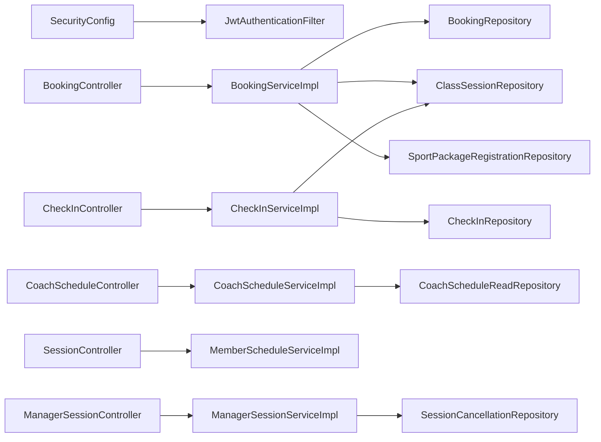

# NX-01 component reuse and architecture

Round 2 remediation: unchanged source analysis revalidated at `d20833c3c16e4f7d95d12b6df21798fc528bd559`. All 220 prior source-file hashes match; 19 explicit high-impact samples pass semantic checks. Counts in this report describe static source, not deployed behavior. See [independent reconciliation](NX-01-inventory-reconciliation.md) and workbook reconciliation (`evidence/workbook-source-reconciliation.md` - local review reference, not published).

Report index (`NX-01-report-index.md` - local review reference, not published). Round 2. Source baseline: `d20833c3c16e4f7d95d12b6df21798fc528bd559`.

Source findings refer to fetched remote main, not the unchanged task checkout. Static evidence does not prove a deployed database or runtime response. NX-00 formal scope approval remains unverified.

The application is a Java 25 Spring Boot monolith with com.sportify.core, identity, catalog and payment business packages. Controllers bind DTOs, services orchestrate transactional work and DTO projection, repositories use Spring Data JPA and selected parameterized JDBC for set-based SQL Server operations. Flyway owns schema evolution; Hibernate validates mapped entities. Training/AI/notification runtime packages are not present in the inspected Java tree. EV-023 (`NX-01-evidence-index.md#ev-023` - local review reference, not published), EV-024 (`NX-01-evidence-index.md#ev-024` - local review reference, not published), EV-026 (`NX-01-evidence-index.md#ev-026` - local review reference, not published)

The diagram contains existing source symbols only. Security runs before controllers; it is not a direct Java invocation dependency of every handler. EV-004 (`NX-01-evidence-index.md#ev-004` - local review reference, not published), EV-006 (`NX-01-evidence-index.md#ev-006` - local review reference, not published), EV-008 (`NX-01-evidence-index.md#ev-008` - local review reference, not published), EV-017 (`NX-01-evidence-index.md#ev-017` - local review reference, not published), EV-018 (`NX-01-evidence-index.md#ev-018` - local review reference, not published), EV-028 (`NX-01-evidence-index.md#ev-028` - local review reference, not published)

## Reuse map

| Component | Status | Reuse scenario | Coupling/guardrail | Evidence |
| --- | --- | --- | --- | --- |
| Identity/JWT/current principal | REUSABLE_WITH_CHANGES | Use existing account/profile IDs and token/role gates; define record/field policy for new flows | No actor ID from AI or member input may override principal | EV-018 (`NX-01-evidence-index.md#ev-018` - local review reference, not published), EV-019 (`NX-01-evidence-index.md#ev-019` - local review reference, not published), EV-022 (`NX-01-evidence-index.md#ev-022` - local review reference, not published) |
| Coach schedule and roster | REUSABLE_WITH_CHANGES | Reuse ownership check and scalar projections as an attendance input seam | Roster is confirmed bookings, not attendance or coach goals access | EV-008 (`NX-01-evidence-index.md#ev-008` - local review reference, not published), EV-009 (`NX-01-evidence-index.md#ev-009` - local review reference, not published) |
| Class/session manager services | REUSABLE_WITH_CHANGES | Reference existing class/session keys and qualification/conflict rules | No duplicate scheduling or implicit historical note access | EV-014 (`NX-01-evidence-index.md#ev-014` - local review reference, not published), EV-015 (`NX-01-evidence-index.md#ev-015` - local review reference, not published), EV-016 (`NX-01-evidence-index.md#ev-016` - local review reference, not published) |
| Booking orchestration | REUSABLE_WITH_CHANGES | Preserve debit, conditional SQL, lock ordering and cancellation | Future attendance must not debit again | EV-005 (`NX-01-evidence-index.md#ev-005` - local review reference, not published), EV-028 (`NX-01-evidence-index.md#ev-028` - local review reference, not published) |
| Arrival CheckInService | EXISTING | Keep current supported staff arrival workflow | Separate arrival from training attendance; D-01 | EV-006 (`NX-01-evidence-index.md#ev-006` - local review reference, not published), EV-007 (`NX-01-evidence-index.md#ev-007` - local review reference, not published) |
| Self-training ACK | PARTIAL | Reuse confirmed booking context only after approved durable semantics | Do not display returned timestamp as saved attendance | EV-004 (`NX-01-evidence-index.md#ev-004` - local review reference, not published), EV-005 (`NX-01-evidence-index.md#ev-005` - local review reference, not published) |
| Member schedule/history pattern | REUSABLE_WITH_CHANGES | Reuse principal scope, page bounds, filters and eligibility checks | New history needs training-specific projection and visibility | EV-005 (`NX-01-evidence-index.md#ev-005` - local review reference, not published), EV-017 (`NX-01-evidence-index.md#ev-017` - local review reference, not published) |
| Core errors/DTO validation | REUSABLE_WITH_CHANGES | Reuse stable error shapes and explicit DTO allowlists | CheckIn note and self-training IDs show validation gaps | EV-020 (`NX-01-evidence-index.md#ev-020` - local review reference, not published) |
| Core audit service | REUSABLE_WITH_CHANGES | Reuse transaction-aware activity records | Choose event fields/retention and avoid raw training/AI PII | EV-029 (`NX-01-evidence-index.md#ev-029` - local review reference, not published) |
| Clock and scheduled jobs | REUSABLE_WITH_CHANGES | Reuse center zone and maintenance orchestration | No notification dispatch inferred from expiry jobs | EV-027 (`NX-01-evidence-index.md#ev-027` - local review reference, not published), EV-026 (`NX-01-evidence-index.md#ev-026` - local review reference, not published) |
| V16 training schema | PARTIAL | Compare existing table names before approving schema design | Personal/session plans, publication and consistency unresolved | EV-010 (`NX-01-evidence-index.md#ev-010` - local review reference, not published), EV-021 (`NX-01-evidence-index.md#ev-021` - local review reference, not published) |
| V17-V19 future schema | PARTIAL | Evaluate existing definitions before adding duplicate chat/workout/notification tables | No runtime adapters or approved lifecycle | EV-011 (`NX-01-evidence-index.md#ev-011` - local review reference, not published), EV-012 (`NX-01-evidence-index.md#ev-012` - local review reference, not published), EV-013 (`NX-01-evidence-index.md#ev-013` - local review reference, not published), EV-026 (`NX-01-evidence-index.md#ev-026` - local review reference, not published) |

## Request, transaction and query conventions

Success DTOs mix immutable records and Lombok bean classes. API errors are centrally translated; filter-level authentication/forbidden responses have dedicated handlers. @Valid activates DTO validation, while business services check IDs, dates, current actors, ownership and mutable state. Do not expose entities as new request bodies or grant mass-assignment of member/coach/status/audit fields. EV-004 (`NX-01-evidence-index.md#ev-004` - local review reference, not published), EV-020 (`NX-01-evidence-index.md#ev-020` - local review reference, not published)

Booking/check-in/session/refund work shares session-first lock ordering. Booking seat reservation and package consumption/restoration use conditional database commands in a transaction. SessionCancellationRepository combines JDBC updates with the caller's JPA transaction; JPA refresh prevents stale state in relevant service paths. Any later attendance/event hook must respect these boundaries and avoid an independently committed balance update. EV-005 (`NX-01-evidence-index.md#ev-005` - local review reference, not published), EV-007 (`NX-01-evidence-index.md#ev-007` - local review reference, not published), EV-028 (`NX-01-evidence-index.md#ev-028` - local review reference, not published), EV-298 (`NX-01-evidence-index.md#ev-298` - local review reference, not published)

Coach reads use scalar projections with a repeated ownership predicate and grouped booking counts. Member/calendar queries use entity graphs and aggregate counts in selected paths. Check-in history uses lazy entity traversal and unpaged lists, so performance reuse needs measurement and projection/pagination design. No performance benchmark or database plan was run. EV-009 (`NX-01-evidence-index.md#ev-009` - local review reference, not published), EV-017 (`NX-01-evidence-index.md#ev-017` - local review reference, not published), EV-270 (`NX-01-evidence-index.md#ev-270` - local review reference, not published)

Runtime configuration defaults to dev and imports an optional local .env file. The detached worktree had no local .env. No application server, production profile, Flyway startup or database probe was launched. CI separates unit and Docker-based SQL Server integration, then package/frontend and aggregate gates. Unit success alone is not full verify or release approval. EV-023 (`NX-01-evidence-index.md#ev-023` - local review reference, not published), EV-024 (`NX-01-evidence-index.md#ev-024` - local review reference, not published), EV-030 (`NX-01-evidence-index.md#ev-030` - local review reference, not published), EV-031 (`NX-01-evidence-index.md#ev-031` - local review reference, not published)

## Existing flow overlap and duplicate implementation risk

| Existing behavior | Future integration overlap | Risk | Required follow-up | Evidence |
| --- | --- | --- | --- | --- |
| Flow 1/2 arrival check-in | F4-REQ-07 and coach attendance | Duplicate check-in route or treating ALLOWED as coach PRESENT | D-01 examples and mapping; preserve aliases | EV-006 (`NX-01-evidence-index.md#ev-006` - local review reference, not published), EV-007 (`NX-01-evidence-index.md#ev-007` - local review reference, not published), EV-010 (`NX-01-evidence-index.md#ev-010` - local review reference, not published) |
| Booking debit/cancel | F4 self-training/attendance submission | Second debit, duplicate credit, deadlocks or changed cutoff | NX-02 no-double-debit states; NX-17 regression | EV-005 (`NX-01-evidence-index.md#ev-005` - local review reference, not published), EV-028 (`NX-01-evidence-index.md#ev-028` - local review reference, not published) |
| Class coach vs session coach | Plan author and roster owner | Incorrect access after reassignment | D-02/D-12 historical ownership matrix | EV-008 (`NX-01-evidence-index.md#ev-008` - local review reference, not published), EV-014 (`NX-01-evidence-index.md#ev-014` - local review reference, not published), EV-015 (`NX-01-evidence-index.md#ev-015` - local review reference, not published) |
| Member booking history | Member training outcomes/history | Passing off bookings as attendance or leaking foreign notes | New approved projection with principal scope | EV-005 (`NX-01-evidence-index.md#ev-005` - local review reference, not published), EV-017 (`NX-01-evidence-index.md#ev-017` - local review reference, not published), EV-010 (`NX-01-evidence-index.md#ev-010` - local review reference, not published) |
| Package/refund/payment | Future session result/event rules | Changing unused-session refund basis or retaining contradictory cancelled attendance | Review RefundServiceImpl and downstream integration tests | EV-298 (`NX-01-evidence-index.md#ev-298` - local review reference, not published), EV-028 (`NX-01-evidence-index.md#ev-028` - local review reference, not published) |
| session_plan vs workout_plan | AI suggestion promoted into plan | Two incompatible plan truth sources | D-02/D-07 and NX-04 reconciliation | EV-010 (`NX-01-evidence-index.md#ev-010` - local review reference, not published), EV-012 (`NX-01-evidence-index.md#ev-012` - local review reference, not published) |
| Catalog/schedule APIs | AI grounding/retrieval | AI bypasses caller authorization or consumes PII-rich roster | D-08/D-14 allowlisted scoped adapter design only | EV-009 (`NX-01-evidence-index.md#ev-009` - local review reference, not published), EV-017 (`NX-01-evidence-index.md#ev-017` - local review reference, not published), EV-018 (`NX-01-evidence-index.md#ev-018` - local review reference, not published) |
| Expiry/cancellation jobs | Notifications | Assuming a scheduled maintenance job already dispatches notices | D-04 event/recipient/deduplication decisions | EV-013 (`NX-01-evidence-index.md#ev-013` - local review reference, not published), EV-026 (`NX-01-evidence-index.md#ev-026` - local review reference, not published), EV-027 (`NX-01-evidence-index.md#ev-027` - local review reference, not published) |

## Corrected finance schema context

V31 creates dbo.cash_coverage, dbo.cash_capture_ticket and dbo.cash_event at lines 9, 18 and 28. These three definitions were omitted by the Round 1 parser. They support existing cash reporting/atomic payment and refund capture; they are not training attendance or notification delivery. V31 also declares five cash-related triggers, and V30 declares two views. Preserve existing payment/refund semantics when considering later integration. Their presence in source does not prove applied database state. See [schema inventory](NX-01-schema-and-data-model-inventory.md).
