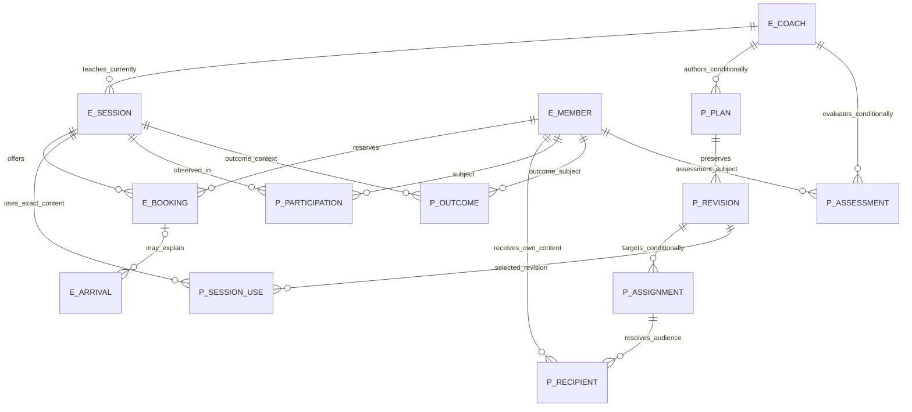

# Conceptual data model

Status: PROPOSED, dependent on D-01, D-02, D-03, D-11, D-12 and D-13. This model covers F4-REQ-01..07; it is not an adopted lifecycle or schema. `E_` denotes existing source-backed concepts, `P_` denotes proposed concepts or a proposed interpretation of an existing scaffold. No relationship grants access by itself.

Arrival is an admission attempt; a booking reserves capacity; participation is a Coach observation. A session can have no participation row while still having a booking and an ALLOWED arrival. Missing observation means unrecorded, not ABSENT. Linking them for navigation must not create or rewrite any of them (D-01/D-13).

## Identity and audience alternatives

The proposed plan identity belongs to its attributable author and sport context, while its selected audience belongs to assignments. Personal assignment targets one Member; class assignment targets a class context and an approved recipient rule. A plan title is not an identity. The session use points at one exact revision; later edits must not silently change the content reported for an earlier session (D-02.REVISION_LIFECYCLE). Whether multiple plans may apply to a session remains open; the diagram permits many uses rather than silently imposing a one-plan limit.

Snapshot recipients make publication audience auditable but must not automatically confer permanent history access. Dynamic recipients reduce snapshot storage but can expose old content to newly enrolled Members and remove old Members' history. Per-member copies isolate sharing but multiply revisions. D-02.RECIPIENTS and D-12.HISTORIC_ENTITLEMENT must select these independently. The recommended snapshot option is PROPOSED, not an approval.

Current assignment authorizes a candidate present write; historical read and correction are separate decisions. Former Coach access is never inferred from authorship alone. Existing schedule Coach assignment does not prove a personal Coach/Member relationship. Personal entitlement requires an approved association or scoped assignment mechanism (D-12.RESOURCE_RIGHTS).

Result values and progress comments are different concepts: a result observes one Member in a session, a progress assessment interprets permitted prior observations. Member-visible comments and private staff notes require separate classification and read projections (D-03.COMMENT_VISIBILITY). No diagnostic score, health inference, retention duration or AI export is selected. Audit metadata must identify a mutation without copying private narratives into broad logs.
