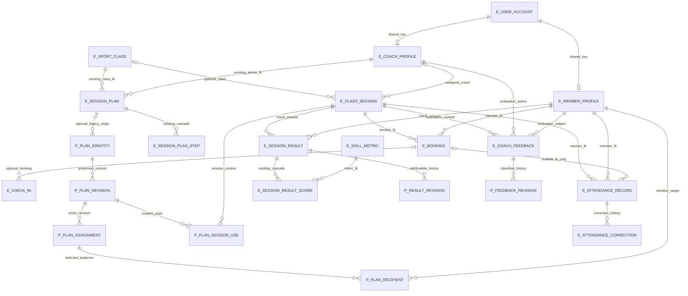

# Logical ERD and relationships

Status: PROPOSED. E_ nodes map to existing SQL declarations in S04-S08. P_ nodes are candidate logical records; names are review aliases, not approved SQL identifiers. Cardinalities below describe storage possibilities, not signed eligibility policy. References use profile shared keys, not invented independent Coach/Member identifiers.

The optional_legacy_origin edge permits zero or one legacy origin per proposed identity. The physical diagram expresses the same relationship. A pure personal plan must not require a fake sport_class row. Either adopt an additive common identity and optional legacy origin (recommendation), or approve relaxing and extending existing plan scope. Never use a dummy class to satisfy the mandatory legacy FK.

| Association | Existing fact or candidate key and cardinality | Ownership/nullability/lifecycle | Decision, risk and alternative |
| --- | --- | --- | --- |
| Account -> Member/Coach | Existing user PK -> profile user_id, each 0..1 profile | Mandatory user per profile; active role must be checked separately | S08/S20/S21; role is not guaranteed by FK |
| Class -> session | Existing nullable class_id; many sessions per class | Session assignment is authoritative for current roster | S05/S15; class ownership alone overgrants |
| Session/Member -> booking | Existing required FKs; many historical bookings; one CONFIRMED pair via filtered index | Cancellation can permit a new booking identity | S06; do not attach attendance to any arbitrary booking for the pair |
| Booking -> arrival | Existing optional booking_id; many attempts | Nullable on unresolved/denied attempts; independent lifecycle | D-01; sole arrival-as-attendance option rejected as recommendation |
| Plan identity -> revision | Proposed stable identity PK; candidate unique identity+revision sequence | 0..many before first draft; revision must have one identity; retained publication content | D-02.REVISION_LIFECYCLE; mutable current-only alternative loses history |
| Legacy plan -> new identity/revision | Proposed optional provenance; one legacy origin may have many revisions | No automatic legacy content is published or member-visible | D-02; map reviewed legacy rows, not inferred audiences |
| Revision -> assignment | Proposed many scoped assignments per exact revision | Personal XOR class target, target field nullability depends on kind; no implicit broadcast | D-02.PLAN_SCOPE/RECIPIENTS; per-session copies alternative |
| Assignment -> recipient | Proposed pair assignment+member if snapshots selected | Each recipient one Member; history entitlement still checked at read time | D-02.RECIPIENTS, D-12.HISTORIC_ENTITLEMENT; dynamic audience alternative |
| Revision/session -> use | Proposed required revision and session FKs, unique identity TBD | Same-sport and scope binding revalidated; historical link preserved after reschedule | D-02.SESSION_RELINK; one-plan versus multiple-use policy unsigned |
| Session/Member -> attendance | Existing UNIQUE(session_id, member_id), optional booking | Candidate current record; booking's member/session must match | D-13.UNIQUENESS/ELIGIBILITY; per-booking alternative needs migration |
| Attendance -> correction | Existing parent FK, many correction rows | Proposed previous/current revision chain and attributable actor; reason private by default proposal | D-13.CORRECTION_AUTHORITY/HISTORY; no overwrite or cascade invented |
| Session/Member -> result | Existing unique pair; proposed separate revision children | Current identity stable; attributed author/context in revision, immutable prior values | D-03.RESULT_HISTORY; append-only result identities alternative changes uniqueness |
| Result revision -> metric values | Existing scores attach current result, not a revision | Proposed revision values need governed metric version; one value per metric if selected | D-03.METRICS/VALIDATION; narrative-only alternative avoids numeric values |
| Session/Coach/Member -> feedback | Existing required independent FKs, many rows allowed | Proposed revision parent and explicit member-visible/staff-only storage | D-03.COMMENT_VISIBILITY, D-12; longitudinal assessment without session needs signed new scope |

For every association, database existence checks are distinct from business entitlement. Neither a valid Member FK nor a Coach FK proves those two may interact. A class recipient list is never returned to another Member. There is no supported tenant key to filter on; future tenant partitioning must address all candidate keys/FKs before enabling multiple centers.
