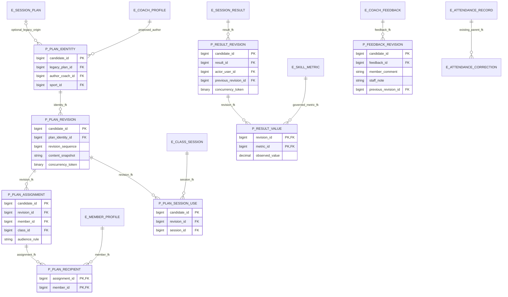

# Physical design options

Status: PROPOSED. All candidate identifiers, types, nullability and indexes below require specific migration approval. No executable DDL accompanies this package. Source S04 supplies the existing scaffold; proposed storage is justified by its documented gaps.

| Criterion | Option A reuse and extend V16 identities | Option B additive revision and scope records with V16 adapters |
| --- | --- | --- |
| Personal/class plans | Relax mandatory class_id and add scoped targets; risks existing class assumptions | New plan_identity can represent both; optional legacy plan reference preserves old IDs |
| Revisions | New children still needed; existing step/result mutations need careful cutover | New plan_revision/assignment/use and result/feedback revision children keep history distinct |
| Attendance | Keep current record and correction scaffold; extend guards/lineage if approved | Same reuse recommendation; a second independent attendance identity would duplicate truth |
| Migration impact | Fewer objects but nullability/semantics of existing plan change | More FKs/indexes and adapter decisions; additive compatibility is easier to stage |
| Privacy | New private/public fields in existing feedback may be accidentally serialized | Explicit revision/projection records can separate private payloads; authorization remains required |
| Legacy data | Need classified lifecycle for all old rows | No automatic publication; reconcile legacy rows under explicit reviewed mapping |
| Risks | Class-only model disguised as full personal support; mutable history | Two plan sources can diverge if both writable; controlled cutover must designate one writer |

Recommendation: Option B for plan identity/revisions and result/feedback history, combined with reuse of existing attendance/current result identities and arrival unchanged. This hybrid is PROPOSED under D-01/D-02/D-03/D-12/D-13, not adopted architecture. A completely separate attendance table is not recommended because V16 already declares the core identity. If signed scope defers personal plans or immutable history, Option A can be reconsidered with an explicit capability exception.

## Physical proposal ERD

P_ names are candidate SQL aliases. Fields are indicative groups in the [dictionary](06-data-dictionary-and-field-classification.md); they are not approved column names. E_ nodes are existing declarations. The legacy origin is nullable; personal plans do not need a legacy row.

Assignment's member_id/class_id are mutually exclusive candidate targets, not both mandatory. Their cardinality and recipient resolution depend on D-02.PLAN_SCOPE/RECIPIENTS. Additional author, created/recorded time, lineage, visibility and expected-current fields described in the dictionary apply even when omitted from the compact diagram. Content snapshot may instead be normalized revision steps; no JSON schema or persisted blob shape is selected.

## SQL Server candidates and rejected shortcuts

Use BIGINT-compatible FKs to match existing targets. Candidate generated PKs may use identity; do not put Member codes or note text into keys. Candidate plan revision number is a per-plan sequence with a unique pair, while current pointer or revision guard is compared atomically. Consider integer optimistic version versus SQL Server rowversion after D-10/JPA testing. A rowversion is a binary change token, not clock time or historical content. [Microsoft rowversion documentation](https://learn.microsoft.com/en-us/sql/t-sql/data-types/rowversion-transact-sql?view=sql-server-ver17) supports that distinction.

Candidate human text uses NVARCHAR with bounds reviewed against FE requirements; reuse existing bounds only for compatibility, not as newly approved UX limits. Metric precision, scale and signed range remain D-03.METRICS; existing DECIMAL(5,2), max_score=10 and feedback rating 1..5 are scaffold facts, not default policy. Avoid float for exact observation comparisons if a decimal model is approved. Test overflow, rounding and multilingual collation rather than inventing a metric unit.

Candidate mutation instants use UTC DATETIME2 with precision explicitly selected and API offset/zone serialization under D-10. Preserve existing center-local DATE/TIME(0) scheduling and existing LocalDateTime arrival under S26. Do not reinterpret historical SYSDATETIME values as UTC; server timezone provenance is unverified. New DATETIMEOFFSET is an alternative if retaining offset is required. A facility zone ID is distinct from a fixed offset; gap/fold handling and local date boundaries must be signed before conversion/backfill.

Proposed access indexes: recipient(member_id, assignment_id), session use(session_id, revision_id), result history(result_id, revision order), feedback(subject, session, revision), and current attendance(member_id, session_id). Reuse current indexes first; inspect execution plans on disposable fixtures before adding duplicate indexes. Index names, INCLUDE columns, filtered predicates and uniqueness are TBD_AFTER_APPROVAL. Existing UNIQUE(session_id, member_id) remains untouched. If a signed history design stores several rows per identity, a filtered current-row unique index or separate stable parent are alternatives, not both required.

SQL Server UNIQUE treats NULL as a participating value in a single nullable key, and CHECK can permit UNKNOWN. Explicit NOT NULL/target XOR checks and nullable-key tests are needed; a naive nullable UNIQUE booking key cannot model multiple unlinked observations. [Microsoft constraints documentation](https://learn.microsoft.com/en-us/sql/relational-databases/tables/unique-constraints-and-check-constraints?view=sql-server-ver17) explains these engine rules. Target collation and actual indexes remain UNVERIFIED_RUNTIME.

Default isolation is not measured. Proposed transactions recheck ownership/eligibility with writes and use deterministic parent lock order consistent with S13/S17; consider row-level optimistic versions for correction conflicts. Snapshot reads do not authorize a stale write. Whole-database SERIALIZABLE or enabling snapshot isolation is not proposed without environment/lock testing. No retention job, default lifecycle enum, cascading deletion, automatic booking, second debit or AI schema coupling is selected.
