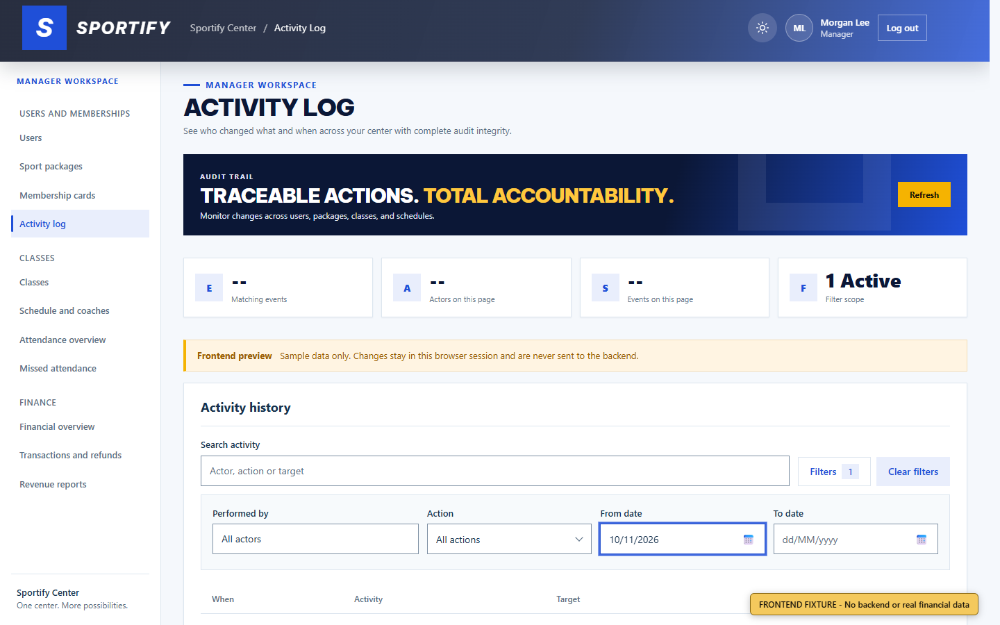
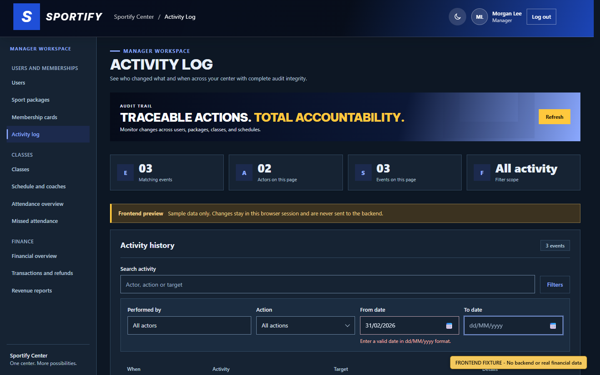
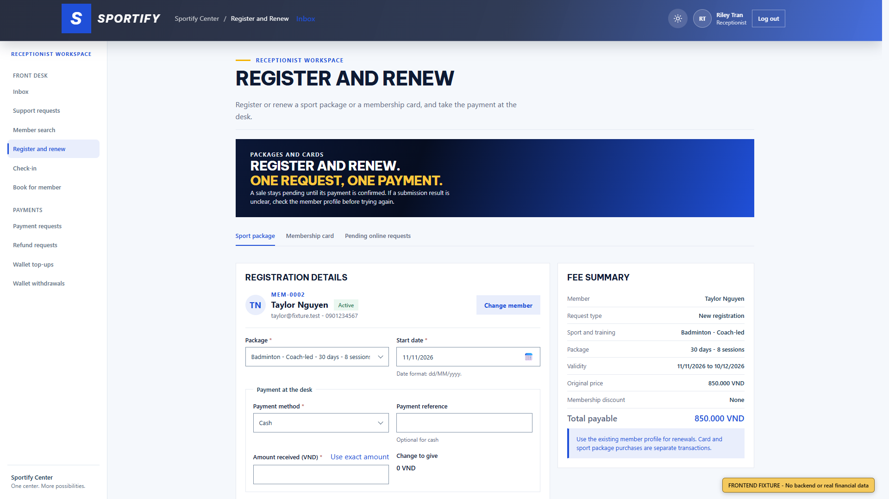
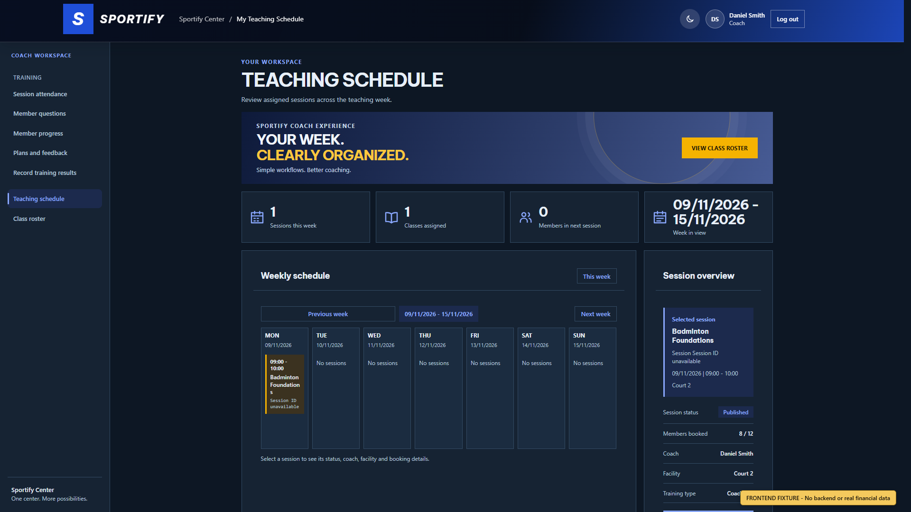
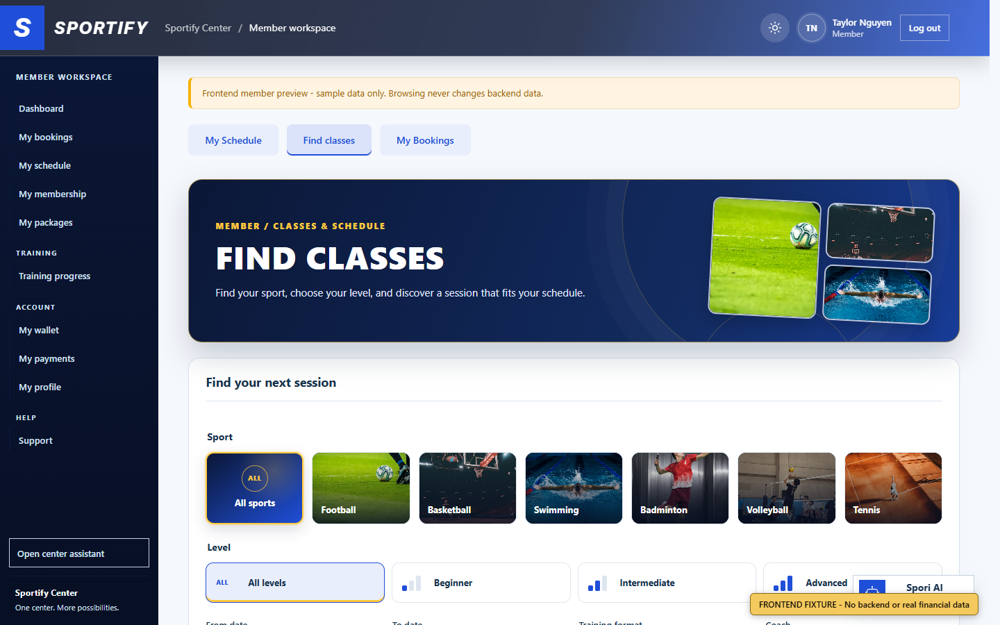

# Test and Browser Evidence

## Automated verification

| Verification | Result |
| --- | --- |
| Focused frontend regression | PASS - 7 files, 189 tests |
| Full frontend regression on final post-#308/#310 rebase | PASS - 129 files, 2,061 tests |
| Frontend lint | PASS |
| Production frontend build | PASS - 329 modules |
| Backend finance report service | PASS - 50 tests, 0 failures, 0 errors, 0 skipped |
| Repository convention check against `bf5a12407117b6ed9f354f13f5c48511f9e2a11c` | PASS |
| `git diff --check` | PASS |
| PR #308 disposable targeted integration | PASS - 5 files, 47 tests; lint; 334-module build |
| PR #310 disposable targeted integration | PASS - 3 files, 86 tests; lint; 332-module build |
| Combined #308/#309/#310 disposable integration | PASS - 129 files, 2,061 tests; lint; 334-module build |

The build retains the repository's existing large-chunk advisory. `npm ci` reports 10 existing moderate dependency advisories; this date-format change neither adds nor suppresses them.

## Browser matrix

- Browser engine: installed Microsoft Edge (Chromium), automated through Playwright Core 1.56.1 from a temporary external tool directory.
- Locale: `en-US`, deliberately different from the required presentation format.
- Viewports: 1440x900 and 1920x1080.
- Themes: light and dark.
- Roles: Home, Manager, Reception, Coach, Member.
- Total: 20 PNG captures, recaptured from implementation commit `ecf8ec046918ecab2f287424cb14d8779d752f5c` after #308 and #310 entered the base.
- Fixture banner: every image visibly states `FRONTEND FIXTURE - No backend or real financial data`.
- Console errors: zero in every capture.
- Detailed hashes and state labels: `SCREENSHOT_MANIFEST.json`.

The preferred interactive browser-control pipe and its in-app browser host were unavailable after retry. The fallback still used the installed Edge browser and genuine DOM/CSS rendering; it did not use image generation or a mocked canvas. The visible valid-state proof includes a selection supplied through the native ISO picker adapter and rendered as `10/11/2026`. The invalid-state proof shows `31/02/2026` with accessible inline validation.

## Representative evidence

## CI

PR URL and final-head GitHub Actions links will be inserted after the single PR is opened and its final evidence commit is pushed.
